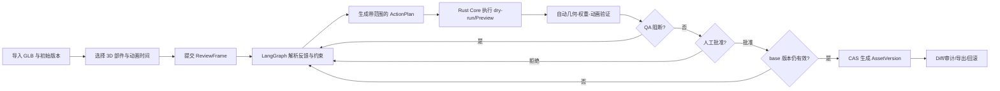
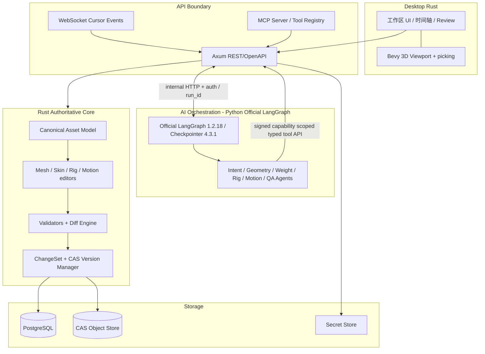
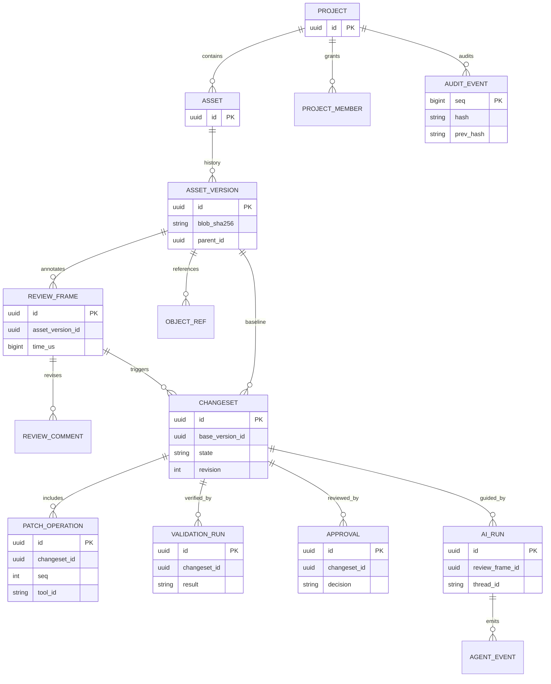
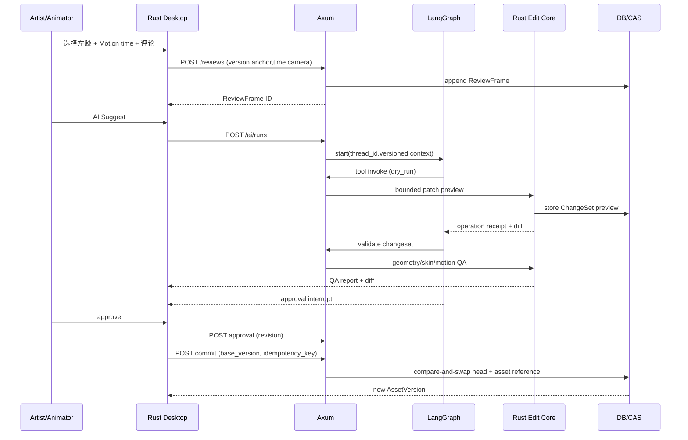
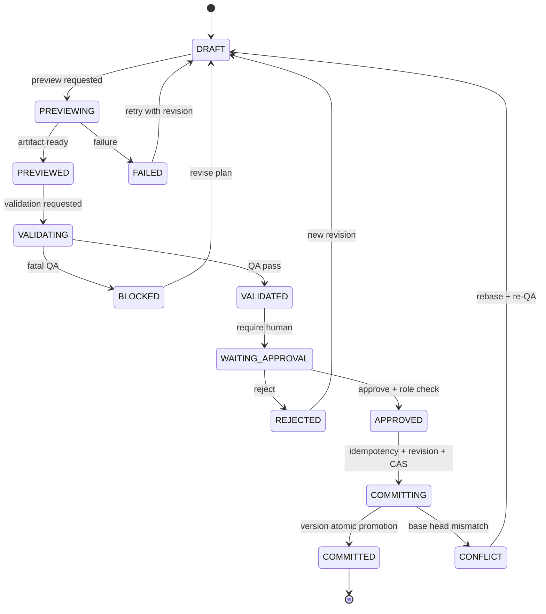

# FrameForge 3D — Rust × LangGraph 反馈式模型与 Motion 编辑平台
**文书集名**：IPA 风格全生命周期工程基线（要件定义书・基本設計書・詳細設計書・試験設計書）
**基线版本**：1.3.0 / **制定日**：2026-10-31 / **状态**：设计基线 + MVP 源代码随附（Rust 编译未验证；Python 语法检查通过；测试未执行）
**语言**：中文为正文，保留日本工程管理术语；**产品代号**：FrameForge 3D（暂定名，不代表可用商标）
**目标实现**：Rust 1.99.1 负责全部 3D 编辑/版本/验证/开放工具 API；Bevy 0.20.1 + bevy_egui 0.43.1 为桌面技术目标；**官方 LangGraph Python 1.2.18 为唯一明确的非 Rust 业务技术例外**，作为独立 AI 编排服务；本地模型推理目标为 Rust Candle；PostgreSQL/SQLite + CAS 为持久化目标。代码 0.1.0 尚未集成 Candle、bevy_egui、GLB Adapter 或 Rust 持久化仓库。全部随附组件必须开源、无许可证费用且允许商业使用。
**交付形态**：本 Markdown 为唯一主设计正文；同包 XLSX 为结构化需求、API、测试、矩阵与记录表；同包源代码为 MVP 0.1.0 实现基线。

> **适用性与限制**：本文件以 IPA《共通フレーム2013》阶段/角色与《ユーザのための要件定義ガイド》《非機能要求グレード2018》为参考，自定义工程文书格式，并非 IPA 官方模板或经 IPA 认证。所有性能数值是建议验收基线，正式开发启动前应在目标硬件与运维条件中核定。尚未有实装或实测结果。

## 文书控制（文書管理票）
| 项目 | 值 |
| --- | --- |
| 管理编号 | FF3D-DOC-ALL-001 |
| 版本 | 1.3.0（2026-10-31 随附 MVP 源代码与实现状态基线） |
| 批准状态 | Draft for baseline review |
| 责任角色 | 产品负责人 / 架构负责人 / QA 负责人 / 安全负责人 |
| 变更原则 | 文书版本 SemVer；任何 P0 需求变更必须更新 RTM/关联测试 |
| 测试记录状态 | 全部为「未执行」；未虚构通过结论 |
| 产品边界 | Rust 资产编辑内核/API/UI + 官方 Python LangGraph 独立服务；Python 不参与几何运算和权威提交；不得依赖付费 LangSmith/LangGraph Platform；许可证与模型权重分别审查 |

## 目录
1. 开发与工程管理基线 / 2. 要件定义 / 3. 基本设计 / 4. 详细设计 / 5. API・数据・AI 编排 / 6. UT 测试设计 / 7. IT 测试设计 / 8. ST 测试设计 / 9. E2E・安全・性能测试设计 / 10. 验收・运维・追踪与审核 / 11. 技术选型・许可证与版本治理 / 12. 官方参考文献

# 1. 工程过程与品质管理（開発計画・品質管理）
## 1.1 对齐 IPA 软件/系统生命周期与交付证据
依据共通フレーム2013：企划（企画）→系统/软件要件（要件定義）→系统方式/软件方式设计（基本設計）→软件详细设计（詳細設計）→实现及单体测试（実装/単体）→结合测试（結合）→系统测试（システムテスト）→运用与保守（運用・保守）。本产品把桌面软件、API 服务与 AI 编排作为可独立部署的子系统，设置共同的需求基线。
| 阶段 | 本交付物内成果 | 入阶段条件 | 出阶段/承认判据 |
| --- | --- | --- | --- |
| 要件定义 | 第2章 + XLSX Requirements/NFR/UseCases | 用户目标/范围 | P0 可测试、边界/非功能明确、PO 批准 |
| 基本设计 | 第3章 + UML/ER / UI/安全边界 | 需求基线 | 架构、接口、数据流、部署与责任明确 |
| 详细设计 | 第4–5章 + API/Tool catalogue | 基本设计审查 | 算法、状态机、错误、数据库/API 契约可实现 |
| 实现+UT | 第6章 + UT 表 | 批准详细设计 | 实现与 UT 按用例可证明达到约束 |
| 结合测试 IT | 第7章 + IT 表 | 单体质量门通过 | 模块接口和异常链路验证 |
| 系统测试 ST | 第8章 + ST 表 | 集成环境完整 | 系统功能/非功能门达标 |
| E2E/安全/性能 | 第9章 + 各测试表 | ST 主链路达标 | 用户场景、攻防和负载经确认 |
| 交付验收/运维 | 第10章 + 发布/缺陷/追踪表 | 报告与风险闭环 | 批准、可回退、运维演练 |

## 1.2 责任和审查
| 主题 | R (实施) | A (最终负责) | C (审阅) |
| --- | --- | --- | --- |
| 业务要件/优先级 | 产品经理 | 产品负责人 | 模型师/动画师/QA |
| 建模内核与格式 | Rust 核心工程师 | 架构负责人 | 技术美术、QA |
| LangGraph/Prompt/外发 | AI 工程师 | AI 技术负责人 | 安全、产品 |
| 权限与攻击面 | 安全工程师 | 安全负责人 | 架构/运维 |
| 测试与门禁 | QA 工程师 | QA 负责人 | 开发/产品 |
| 发布与灾备 | SRE | 运维负责人 | 安全/QA |

## 1.3 生命周期与变更控制
- 文档与设计稿同版本控制；修改先更新要件→基本设计→详细设计→测试，完成审查后再修改生产代码。
- 所有变更请求 CR 必须包含影响 FR/NFR、模块、schema/API、格式兼容、数据迁移、回滚和验收测试。
- 检查点：REQ-REVIEW / ARCH-REVIEW / DDD-REVIEW / TEST-REVIEW / RELEASE-REVIEW；每个门禁必须留存签名或工单编号。
- AI 输出永远不能替代正式审查的责任主体；生成内容必须保留模型、工具版本、输入版本、证据与批准人。

# 2. 软件要件定义书（ソフトウェア要件定義書 / SRS）
## 2.1 业务背景、问题与目标
现有 3D 审阅多停留于截图/评论，创作者需手动在 DCC 中定位反馈并编辑网格、蒙皮与动画，难追踪「哪条反馈导致哪项修改」以及验证结果。目标是在**同一个资产工作台**用明确的 ReviewFrame、版本化 ChangeSet、受约束的 AI 工具实现从反馈到实际修改，再到可审计审批。
## 2.2 项目目标/KPI（目标值，实施前确认）
| KPI | 建议值 | 计算口径 | 确认方式 |
| --- | --- | --- | --- |
| 反馈定位成功率 | ≥ 95% | 已固定版本的 ReviewFrame 正确恢复锚点/姿态/相机 | 100 标准回放样本 |
| AI 不安全直接提交 | 0 | 未获批准直接产生正式版本的次数 | 自动化安全测试 |
| 基础模型完整往返率 | ≥ 99% | 正式支持格式测试资产不丢未编辑语义 | golden corpus |
| 权重/旋转有效率 | 100% | 正式批准版本均符合数值约束 | 每次自动 QA + 合规测试 |
| 需求测试覆盖 | 100% P0 / 100% MVP | 均有至少 1 条可执行测试 | XLSX traceability |

## 2.3 用户、利益相关者与操作权限
| 角色 | 角色目标 | 允许操作 |
| --- | --- | --- |
| Artist（美术师） | 上传/查看/手动修模型 | 资产读写、反馈、预览、编辑 |
| Rigger（绑定师） | 骨骼/权重调整 | 绑定/蒙皮操作与校验 |
| Animator（动画师） | 修改 Motion | 动画关键帧与曲线编辑 |
| Reviewer（审阅者） | 留评论和校验结果 | 反馈/查看 Diff；审批权限另授 |
| Approver（批准者） | 签发变更 | 审阅后批准/拒绝，不默认可改模型 |
| Admin（管理员） | 项目权限和凭证管理 | 租户、供应商、插件与配额配置 |
| Operator（运维） | 备份、监控 | 服务管理/审计，但无业务编辑权限 |
| External Agent（外部） | 调用开放接口 | 显式工具 capability 下的最小权限 |

## 2.4 范围（スコープ）与版本边界
**产品 MVP 目标**：Windows / Linux 桌面 3D UI（Windows MVP 优先）；glTF/GLB；Mesh 顶点局部编辑及材质参数；蒙皮四影响基础数据与归一化/笔刷；骨骼姿态；TRS 动画关键帧/重定时；ReviewFrame；Diff；人机审批；Rust API；官方 LangGraph Python StateGraph 工作流；REST/WS/MCP；内置版本和审计。**随附代码 0.1.0 仅实现 canonical JSON 资产模型上的顶点/四影响权重/关键帧修改、ReviewFrame 数据、REST 预览与审批提交、LangGraph interrupt 工作流；GLB 读写、完整桌面编辑器、WS/MCP 和持久化 Rust 资产仓库仍未实现。**
**PH2**：FBX/OBJ/VRM 转换适配，IK/FK、Motion retarget、复杂网格拓扑、根运动/足锁、GitGit/MinIOS3 接入；业务前置为足够测试语料及许可证评估。
**明确不包含**：通用 DCC 全功能替代、无损导入/编辑全部 BLEND/FBX 私有语义、自动保证艺术质量、未审批直接修改正式资产、未申明的高维影响（> 4 bones per vertex 如数据包含 JOINTS_1 时须保留或用能力检查阻断编辑）。
## 2.5 领域术语与单位
| 术语 | 精确定义 |
| --- | --- |
| MotionFrame | 由 animation_time_us 和显示 FPS 分数计算的动作画面。动画曲线存储基于绝对时间。 |
| ReviewFrame | 只追加的审阅快照，绑定资产版本、相机、选择锚点、动画时间和文本；不是 Motion 的关键帧。 |
| ChangeSet | 只针对某个 base_version 的受限操作集合及预览/验证/审批证据。 |
| AssetVersion | 内容寻址、不可变的模型/动画状态版本。 |
| Semantic Anchor | 版本作用域内的 mesh/primitive/vertex/face/joint/track 标识与空间锚点。 |
| Skin Weight | 单顶点最多 N 个关节影响及权重，MVP 编辑 N≤4（多 influence 数据的完整保留另处理）。 |
| 时间 | 微秒 int64（业务层）；导出 glTF sampler.input 秒 float32，量化误差需测量。 |
| 坐标系 | 内部约定右手 Y-up、米（GLB/glTF 基准）；UI 可改变视图但不隐式改变资产基准。 |
| Quaternion | 内部 xyzw，单位长度、同一规范化/短弧插值策略。 |
| API Key | 模型供应商密钥，由用户配置，外发和权限属于独立安全策略。 |

## 2.6 业务流程（業務フロー）


## 2.7 用例清单（ユースケース一覧）
| UC ID | 用例 | 角色 | 基本处理 |
| --- | --- | --- | --- |
| UC-001 | 创建项目与导入模型 | Artist | 上传 GLB→校验→hash→生成资产版本→浏览 |
| UC-002 | 标注某个组件/动画时间 | Reviewer | 点选骨骼/面→确定 00:01.167s→填写反馈→生成 ReviewFrame |
| UC-003 | 根据反馈生成 AI 计划 | Artist | 提交 comment→指定模型/effort→意图解析→生成 ActionPlan |
| UC-004 | 审查并批准 AI 变更 | Approver | 读 Diff/QA→批准→CAS 提交→生成新版本 |
| UC-005 | 修改模型局部顶点 | Artist | 限定点集→预览 Delta→拓扑验证→审批 |
| UC-006 | 权重笔刷 | Rigger | 选 joint→笔刷→锁定权重→归一化→热力图 |
| UC-007 | 修改绑定姿态 | Rigger | 选择关节→修改局部 rotation→评估约束→预览 |
| UC-008 | Motion 调整和重定时 | Animator | 选动画→关键帧操作→采样→足滑检查 |
| UC-009 | 版本比较及回滚 | Reviewer | 选 A/B→三维差异→补偿变更→批准 |
| UC-010 | 使用 MCP 外部 Agent | Developer | 申请工具 token→注册 scope→调用预览→审批→提交 |
| UC-011 | 团队协同 | Lead | 分配反馈→订阅进度→处理冲突→审计 |
| UC-012 | 多模型供应商配置 | Admin | Key 存储→供应商连通性→成本预算→禁云模式 |
| UC-013 | 离线本地编辑 | Artist | 不填 AI Key→本地 GLB→手动编辑→导出 |
| UC-014 | 插件添加能力 | Developer | 声明 manifest→签名/审核→沙箱→注册工具 |
| UC-015 | 事故恢复 | Operator | 故障检测→重启→Checkpoint 恢复→审核版本完整性 |

## 2.8 功能需求表（機能要件）
| ID | 模块 | 需求（可测试） | 验收标准 | 优先级 | 阶段 | 详细设计 |
| --- | --- | --- | --- | --- | --- | --- |
| FR-001 | ASSET | 导入并解析 glTF 2.0/GLB，逐项校验格式、引用、bufferView、accessor 与扩展依赖 | 合法示例可导入；损坏/越界返回结构化错误，原始文件不变 | P0 | MVP | D-ASSET |
| FR-002 | ASSET | 资产内容哈希、去重、元数据和预览缩略图 | 相同二进制 hash 可重用存储；不同项目不得越权互见 | P0 | MVP | D-ASSET |
| FR-003 | ASSET | 显示模型层级、Mesh/Primitive/Material/Node/Skin/Animation | 选中树节点时高亮视口；查找结果与真实 ID 一致 | P0 | MVP | D-VIEW |
| FR-004 | ASSET | 导出有效 GLB 并保留未编辑数据、节点结构与扩展 | 往返导入导出不丢受支持的数据；未支持扩展显式阻断或标注 | P0 | MVP | D-EXPORT |
| FR-005 | ASSET | 导入可配置的 FBX/OBJ/VRM 转换任务 | 转换前显示能力矩阵；失败不覆盖源；非 MVP 时只提供插件接口 | P2 | PH2 | D-ADAPTER |
| FR-006 | VIEW | 三维视口 Orbit/Pan/Zoom、正交/透视、骨骼与权重覆盖层 | 视角变化流畅；遮挡/深度选取一致且可重现 | P0 | MVP | D-VIEW |
| FR-007 | VIEW | 网格/面/顶点/骨骼/材质/动画轨道定位与选择 | 选择返回稳定部件 ID + 选取坐标与资产版本 | P0 | MVP | D-SELECT |
| FR-008 | VIEW | 分屏叠加差异、切换原始/预览/批准版本 | 能够比较几何、权重、曲线数值与渲染预览 | P1 | MVP | D-DIFF |
| FR-009 | VIEW | 多标签工作区、快捷键、时间轴及关键帧导航 | 任意切换不丢未提交草稿，状态清晰 | P1 | MVP | D-UI |
| FR-010 | REVIEW | 以文字/涂鸦/锚点反馈绑定资产版本、组件、空间位置、相机与动画时间 | 点击评论可重现视角与对应动画时刻 | P0 | MVP | D-REVIEW |
| FR-011 | REVIEW | 每次反馈生成不可变 ReviewFrame（不增加动画真实帧） | 同一动画时刻允许多个 ReviewFrame；回放不改 FPS | P0 | MVP | D-REVIEW |
| FR-012 | REVIEW | 反馈包含严重度、状态、负责人、讨论线程与附件 | 评论状态流转有权限校验、历史审计 | P1 | MVP | D-REVIEW |
| FR-013 | REVIEW | AI 为反馈生成结构化意图、定位候选、假设与置信提示 | 含引用目标 ID、约束、风险、需人工澄清项 | P0 | MVP | D-AGENT |
| FR-014 | REVIEW | 支持撤销/驳回/再编辑反馈与关联变更请求 | 审查记录只追加版本，不直接静默改写 | P1 | MVP | D-REVIEW |
| FR-015 | MESH | 非破坏式顶点位移、法线/切线更新及材质参数调整 | 预览不修改已批准版本；导出前 geometry 校验 | P0 | MVP | D-MESH |
| FR-016 | MESH | 基于 Mesh/Primitive/Vertex/Face 等稳定锚点生成局部编辑掩码 | 拓扑变化后锚点映射不确定则阻断自动提交 | P0 | MVP | D-MESH |
| FR-017 | MESH | 可选细分、拓扑重建、UV 与 Shape Key 编辑插件 | 接口可用；核心 MVP 不承诺无损编辑复杂拓扑 | P2 | PH2 | D-ADAPTER |
| FR-018 | MESH | 冲突检测与限幅：最大位移、边界盒增长、退化三角形 | 超限操作拒绝且无资产写入 | P0 | MVP | D-VALID |
| FR-019 | SKIN | 对选定顶点和骨骼进行权重增减、归一化与锁定骨骼保护 | 权重非负、有限、每顶点和约 1，锁定权重不变 | P0 | MVP | D-WEIGHT |
| FR-020 | SKIN | 权重笔刷：半径、强度、衰减、镜像、平滑 | 受控编辑区域内改变；结果可数值复算 | P1 | MVP | D-WEIGHT |
| FR-021 | SKIN | 骨骼树、绑定姿势与 inverseBindMatrices 检查 | 无循环、合法 joint 索引、矩阵有限 | P0 | MVP | D-RIG |
| FR-022 | SKIN | 姿态编辑、局部/全局坐标变换与镜像约束 | 约束超限拒绝或按明确策略裁剪并报告 | P1 | MVP | D-RIG |
| FR-023 | SKIN | IK/FK 转换与约束求解 | 内核插件接口稳定，基础两骨 IK 后续版本实现 | P2 | PH2 | D-IK |
| FR-024 | SKIN | 权重编辑比较：热力图、受影响顶点/骨骼与最大差值 | 输出数值差异统计及可视差异 | P1 | MVP | D-DIFF |
| FR-025 | MOTION | 播放、暂停、逐帧、变 FPS 显示，按时间而非序号存储曲线 | 不同 FPS 下同一时间采样稳定 | P0 | MVP | D-MOTION |
| FR-026 | MOTION | 编辑 TRS 关键帧、插入/移动/删除及插值规则 | 时间严格递增，Quaternion 归一且路径合法 | P0 | MVP | D-MOTION |
| FR-027 | MOTION | 关键帧重定时、区间平移、偏移叠加与指定骨骼子树 | 约束范围外的曲线与关键帧保持不变 | P0 | MVP | D-MOTION |
| FR-028 | MOTION | Motion 变更前后叠影、姿势误差与足滑检测 | 生成每段数值报告；无法判断标为需人工审查 | P1 | MVP | D-QA |
| FR-029 | MOTION | 根运动提取、接地接触、Foot Lock 与动作平滑 | 以独立插件提供，明确坐标系与接触条件 | P2 | PH2 | D-MOTION |
| FR-030 | MOTION | Retarget：不同骨架映射、骨长缩放与命名映射 | 后续版本；缺失骨骼或映射歧义时拒绝自动提交 | P2 | PH2 | D-RETARGET |
| FR-031 | AI | 支持用户自填模型供应商 API Key、模型选择、effort 与预算 | 密钥不写入日志/项目/提示词；支持禁用云模型 | P0 | MVP | D-AI-CONFIG |
| FR-032 | AI | LangGraph 以可持久化状态机执行解析→规划→预览→验证→审批→提交 | 任何中断后可根据 thread_id 幂等恢复 | P0 | MVP | D-GRAPH |
| FR-033 | AI | 按目标分配 Geometry/Rigging/Weight/Motion/QA Agent | 有明确工具白名单、动作计划与反馈回执 | P0 | MVP | D-GRAPH |
| FR-034 | AI | AI 仅通过类型化工具 API 请求编辑，不直接执行任意脚本 | 越权调用、未知 tool 与 schema 错误被拒绝 | P0 | MVP | D-TOOL |
| FR-035 | AI | 修改计划包含 impact scope、预期变化、置信说明和验收测试 | 修改前展示机器可读计划，审阅可编辑 | P0 | MVP | D-GRAPH |
| FR-036 | AI | 通过几何/绑定/动画自动验证后才能发起审批 | 严重错误禁止提交；警告需按策略处理 | P0 | MVP | D-QA |
| FR-037 | AI | 支持人在回路审批、修改参数、驳回、再规划 | 审批者明确身份；拒绝不生成已批准版本 | P0 | MVP | D-GRAPH |
| FR-038 | AI | Agent 上下文引用的是版本化数据快照而不是不受控当前状态 | 版本变更必须重新验证，否则冲突 | P0 | MVP | D-GRAPH |
| FR-039 | AI | 多模型供应商适配及离线模式（无 AI 手动编辑） | 未配置模型时可运行核心编辑功能 | P0 | MVP | D-AI-CONFIG |
| FR-040 | AI | AI 调用配额、超时、重试、熔断和成本统计 | 429 等短时故障退避；不会重复 commit | P1 | MVP | D-GRAPH |
| FR-041 | API | 所有可变更操作提供版本化 REST/OpenAPI 接口 | schema 与实现 CI 比较；错误结构一致 | P0 | MVP | D-API |
| FR-042 | API | 视口协同与任务进度通过 WebSocket 增量事件 | 断连后使用游标重放，无损状态校对 | P1 | MVP | D-EVENT |
| FR-043 | API | MCP 工具服务器公开最小权限的 review/edit/verify API | 工具需要权限与 approved scope；只支持受限操作 | P1 | MVP | D-MCP |
| FR-044 | API | 插件 SDK：工具注册、能力声明、版本与沙箱隔离 | 未签名或不兼容插件不能被默认执行 | P1 | MVP | D-PLUGIN |
| FR-045 | VERSION | 预览修改使用 ChangeSet，提交时 CAS 检查 base_version | 冲突返回 409，不覆盖他人批准版本 | P0 | MVP | D-VERSION |
| FR-046 | VERSION | 内容寻址版本图、差异与可逆操作撤销 | 所有版本可追溯，undo 产生补偿变更而非删审计 | P0 | MVP | D-VERSION |
| FR-047 | VERSION | 变更影响报告包含风险、测试结果、AI 证据链和人工审批 | 每次发布可查询完整来源及结果 | P0 | MVP | D-AUDIT |
| FR-048 | VERSION | 可选与 GitGit / MinIOS3 的外部版本及存储集成 | 默认内置实现；外部适配故障不破坏版本原子性 | P2 | PH2 | D-INTEGRATION |
| FR-049 | SEC | 项目/资产/版本/工具的角色权限与最小授权 | 越权读取/编辑返回 403 或隐藏为 404 | P0 | MVP | D-SECURITY |
| FR-050 | SEC | 审计日志、密钥保护、隔离未知模型和不可信元数据 | 可追溯 actor/action/hash；敏感内容脱敏 | P0 | MVP | D-SECURITY |
| FR-051 | OPS | 容器化部署、健康检查、指标、备份恢复与故障告警 | 单节点/桌面部署可用；恢复演练达预设 RTO | P1 | MVP | D-OPS |
| FR-052 | OPS | 语言 zh-CN、ja-JP、en-US 与无障碍基础支持 | 用户语言可切换；错误码与术语保持一致 | P1 | MVP | D-UI |
| FR-053 | AI | 完全离线开源 AI 模式：不填商业 API Key，在许可审核的开源模型与 Rust 推理后端下执行意图解析/结构化编辑建议 | 无互联网运行 AI 生成受限 ActionPlan；不兼容模型时明确降级为无 AI 手动编辑，禁止暗中调用云服务 | P0 | MVP | D-AI-CONFIG;D-GRAPH |

## 2.9 非功能需求表（非機能要求グレード2018 六大类映射）
以可用性、性能・拡張性、運用・保守性、移行性、セキュリティ、システム環境・エコロジー为分类参考；对本产品必要的正确性/质量管理另列扩展类。具体测试机、数据与 SLA 尚待签署。
| ID | 分类 | 要求 | 计量指标/验收 | 优先级 | 设计 |
| --- | --- | --- | --- | --- | --- |
| NFR-001 | 可用性 | 编辑结果原子提交，不产生半版本 | 0 个半提交版本；注入故障后事务回滚成功 | P0 | D-VERSION |
| NFR-002 | 可用性 | 后端服务可恢复并可无损继续 pending 审批 | 服务重启后同 thread_id 状态可恢复；pending 不丢失 | P0 | D-GRAPH |
| NFR-003 | 性能·扩展 | 基准资产加载：≤ 100MB、≤ 1M vertices 的 GLB | 基准机器冷加载 P95 ≤ 8s（待实验确认） | P1 | D-ASSET |
| NFR-004 | 性能·扩展 | 视口交互延迟及渲染预算 | 指定基准 GPU 1080p 非重计算 P95≥30 FPS；点击反馈 P95≤200ms | P1 | D-VIEW |
| NFR-005 | 性能·扩展 | 编辑预览响应时间 | 10K 顶点权重变更在基准机 P95 ≤ 2s；具体数据集固化 | P1 | D-WEIGHT |
| NFR-006 | 性能·扩展 | 并发会话和任务隔离 | 50 并发审阅、10 并发 AI 作业下无脏写（基准部署） | P1 | D-API |
| NFR-007 | 运营·维护 | 日志追踪与链路观测 | 100% 提交与预览链路有 trace_id / request_id；日志不含 API Key | P0 | D-OPS |
| NFR-008 | 运营·维护 | 配置、插件、API 向后兼容策略 | 同一 major 内新增字段不破坏旧客户端；破坏性修改需新 major | P1 | D-API |
| NFR-009 | 运营·维护 | 备份、迁移和恢复程序 | 每日备份；RPO≤24h、RTO≤4h（初始目标，生产需确认） | P1 | D-OPS |
| NFR-010 | 运营·维护 | 审查记录保留期可配置 | 默认为 365 天；法定留存由部署方决定；删除按策略审计 | P1 | D-AUDIT |
| NFR-011 | 迁移性 | glTF 导入导出与外部格式转换 | golden fixtures 往返顶点/动画误差在数值预算内 | P0 | D-EXPORT |
| NFR-012 | 迁移性 | 数据库 schema 可升级并支持回滚方案 | migration 幂等；不可逆变更必须先备份及批准 | P0 | D-DATA |
| NFR-013 | 安全性 | 传输加密与静态密钥保护 | 服务端 TLS1.2+（优先 TLS1.3），用户令牌密钥不明文落盘 | P0 | D-SECURITY |
| NFR-014 | 安全性 | RBAC + 项目级 ABAC、短期 access token | 未授权 100% 拒绝；提交权限独立于评论权限 | P0 | D-SECURITY |
| NFR-015 | 安全性 | 不可信文件、插件、Prompt 注入防护 | 所有越界读/任意工具执行尝试被拒绝并审计 | P0 | D-SECURITY |
| NFR-016 | 安全性 | 可控外部 AI 数据出境策略 | 默认明确征求许可；禁用外发时内容不发给云模型 | P0 | D-AI-CONFIG |
| NFR-017 | 环境·生态 | 跨平台运行 | Windows11 x64 MVP；macOS/Linux 为适配与 ST 目标 | P1 | D-OPS |
| NFR-018 | 环境·生态 | 资源回收与任务上限 | 内存/磁盘/Token 预算可配，超限回收任务不破坏资产 | P1 | D-OPS |
| NFR-019 | 正确性 | 权重归一化误差界 | 在 f32 处理后每顶点 \|Σw−1\| ≤ 1e-4，且 w∈[0,1] | P0 | D-WEIGHT |
| NFR-020 | 正确性 | 动画旋转、时间与数值有效性 | Quaternion 长度误差 ≤1e-4、时间单调且无 NaN/Inf | P0 | D-MOTION |
| NFR-021 | 正确性 | 拓扑和绑定合法性 | 不接受越界 joint、退化三角形超阈值、骨骼循环 | P0 | D-VALID |
| NFR-022 | 质量管理 | 需求-设计-测试可追踪覆盖 | 全部 P0/全部 MVP FR 和全部 NFR 至少一条可执行测试 | P0 | D-QA |
| NFR-023 | 可用性 | 人为审批可审查并可拒绝 | 高风险变更 100% 人工批准；权限与审批前后版本一致 | P0 | D-GRAPH |
| NFR-024 | 运营·维护 | 敏感审计记录防篡改 | 审计事件有顺序号与哈希链，篡改校验失败 | P1 | D-AUDIT |
| NFR-025 | 许可证合规 | 运行必选及发行内全部直接、传递依赖与素材、模型权重均须开源、免费且许可证允许商业使用；默认许可证策略为宽松许可 | 依赖全图/字体/资产/模型许可证 SBOM 与 NOTICE 评审通过；禁用未核验和强 copyleft 捆绑 | P0 | D-LICENSE |
| NFR-026 | 依赖最新稳定与可复现 | 以 2026-10-31 官方可查的最新稳定版本为设计基线；升级需兼容与安全门禁，不能直接使用 nightly/rc | Cargo.lock+固定 Rust toolchain；CI 对比 registry/官方 release；版本落后或不兼容有 ADR 审批 | P0 | D-DEPS |
| NFR-027 | Rust 资产核心与 Python AI 隔离 | 正式模型编辑、骨骼、权重、Motion、图形与业务提交全部 Rust；官方 LangGraph Python 仅独立编排；未安装 Python 时仍可手动编辑 | 清洁环境无 Python/Blender/云连接通过 Rust 手动 E2E；安装官方 LangGraph 之后通过跨进程 Agent E2E，服务不可用时无资产污染 | P0 | D-ARCH;D-GRAPH |

## 2.10 系统边界、假设与限制
- 用户提供或合法授权处理的 3D 资产；上传来源、许可证由部署方管理。
- 默认本地单用户可离线使用；团队合作时开启后端权限/数据库/对象存储。
- LLM 结果不稳定，人工必须能理解修改 diff、风险和回滚方案；AI 不承诺 100% 正确。
- 复杂 FBX/BLEND/Proprietary Motion 只能通过适配器并出示有损变换/许可证/版本提示。
- 正式支持方案优先使用 Rust + Candle 本地推理或可商用的开源本地推理服务，模型权重单独进行 SPDX/权利审核。第三方收费或闭源供应商仅属用户自选 BYOK 外部扩展，非必选、非免费开源基线；effort/tool calling 以能力协商为准。
- API 首次交付主要对象：/api/v1；无 SLA 签署前不做可用性商业承诺。
## 2.11 假设决策记录（ADR）
| ADR | 决策 | 原因/替代 | 剩余风险 |
| --- | --- | --- | --- |
| ADR-001 | Rust 为唯一资产变更权威，Agent 编排使用官方 LangGraph Python 1.2.18 + 官方 Checkpoint（独立 MIT 服务） | 优先采用原生官方实现，避免第三方 Rust LangGraph 的兼容性风险；不依赖付费 SaaS | Python 服务增加部署/监控成本；通过开放 HTTP 契约、熔断与手动编辑降级控制风险 |
| ADR-002 | Canonical 格式 glTF/GLB 优先，BLEND 非核心 | 开放标准便于往返/校验 | 格式转换语义差异 |
| ADR-003 | Bevy 0.20.1 + bevy_egui 0.43.1 + egui 0.37.0；Cargo.lock 固定 | 官方 bevy_egui 支持矩阵确认 Bevy 0.20→0.43 | 仍须运行编译/集成测试；升级不自动放行 |
| ADR-004 | ReviewFrame 与 MotionFrame 独立 | 防止每次反馈污染动画帧 | UI 用户理解成本 |
| ADR-005 | 审批与提交强制 CAS | 防止旧版本覆盖/竞态 | 冲突需要重做 preview |
| ADR-006 | 对象存储 + PostgreSQL 做版本元数据 | 媒体大文件 CAS，业务实体关系 | 一致性及 GC 设计 |
| ADR-007 | 默认禁用任意脚本执行，仅结构化工具 | 可审计/可限制能力 | 复杂艺术修改能力受限 |
| ADR-008 | Blender 不在标准产品发行包和自动安装依赖中；仅用户自行安装后可通过进程边界连接 | Blender GPL 可商业使用，但分发/组合义务与宽松许可证策略不同 | 开启前人工法律与许可证审查；不得宣称无条件可闭源捆绑 |
| ADR-009 | 默认仅依赖可商用开源组件，SPDX 宽松许可 allowlist；拒绝未知许可证与强 copyleft 自动入库 | 避免付费/闭源/传递依赖污染 | 依赖全图、附带素材与模型权重必须审查 |
| ADR-010 | Rust 1.99.1、Bevy 0.20.1 等采用截至 2026-10-31 的设计选型，逐包最新性/兼容性须由发行门禁再核实；后续版本通过 CI 受控升级 | 最新性与可复现并重 | 尚无实际 Cargo.lock/构建产物，不宣称已构建通过 |
| ADR-011 | 默认推理 Rust Candle + 许可审核的开源权重；本地离线保底；RustFS/SeaweedFS 与 BYOK 为可选集成 | 无强制云模型订阅 | 模型特定架构可运行性与 GPU 平台需单独验证 |
| ADR-012 | 官方 LangGraph 1.2.18、langgraph-checkpoint 4.3.1、checkpoint-postgres 3.2.0；Python 独立服务，非必选手动编辑依赖 | 官方状态图、checkpoint、interrupt/resume 能力更成熟，MIT 免费商用 | Python 整体依赖锁/发行包及跨进程幂等须单独测试 |
| ADR-013 | 编排采用 Python 3.13.18 兼容基线，非 3.15.2 的最新版解释器 | LangGraph PyPI 明示 3.13 支持；优先兼容性和安全补丁，3.15.x 后续实证验证 | 必须另行测试 3.15 后才可升版，不得把最新功能系列视为自动兼容 |


# 3. 基本设计书（基本設計書 / HLD）
## 3.1 逻辑分层与职责


## 3.2 运行形态与部署配置
| 形态 | 前端/渲染 | 核心/API | AI | 存储 | 约束 |
| --- | --- | --- | --- | --- | --- |
| 个人桌面离线 | Rust Desktop Bevy | 嵌入进程或 loopback Rust API | AI 关闭时无 Python；AI 开启时启动隔离 Python LangGraph 进程 | SQLite metadata + 本地 CAS；与服务器模式领域接口一致 | 无云凭证也可编辑与导出 |
| 团队服务器 | Rust Desktop + 未来 Web client | Axum Rust 服务 | LangGraph Python 自托管 worker（MIT）+ Rust Candle 推理工具；可选授权外部模型 | PostgreSQL 18.6 + CAS；可选 RustFS/SeaweedFS S3 | RBAC/TLS/审计+任务队列 |
| 插件模式 | 既有 DCC 插件 | REST/MCP | LangGraph 复用 | 调用统一版本数据 | DCC 只传受限操作与 preview |

**一致性说明**：本地 SQLite 与服务端 PostgreSQL 使用同一领域 Repository 接口，并共享版本提交状态机，但 SQL migration 是独立实现；MVP 可先完成服务器 PostgreSQL 与本地单机 SQLite，两个配置均须测试。
## 3.3 业务模块列表（模块抽象合并）
| 模块组 | 合并职责 | 外部契约 |
| --- | --- | --- |
| Asset Studio | 导入、视口、选择、导出 | asset REST / import-export jobs |
| Review Workspace | 评论、ReviewFrame、差异/回放 | review REST / WS |
| Edit Kernel | Mesh/Weight/Rig/Motion 并行工具 | typed tools / Rust traits |
| AI Orchestrator | 官方 LangGraph 状态图、模型选择、interrupt/resume、人工批准 | Python LangGraph service / Rust Tool API |
| Version & QA | ChangeSet、diff、验证、审批、提交 | changesets API |
| Platform | Auth、插件、审计、对象库、运维 | Admin / MCP / diagnostics |

## 3.4 核心实体 ER 模型


## 3.5 基础 UI 画面/状态设计
**主工作区**：顶部（项目/资产版本/导入导出）、左侧（场景树/骨骼层级）、中央（3D viewport + picking + 权重热力图）、右侧（ReviewFrame 评论 / AI Plan / QA / Diff）、底部（Motion 时间轴 / keyframe / ReviewFrame 时间轴独立标签）。
画面状态：EMPTY→IMPORTING→READY→EDIT_PREVIEW→VALIDATING→WAITING_APPROVAL→COMMITTED；error/pending 保存草稿。UI 不允许在审批前将 preview 伪装为已批准；明显标识「preview」与「正式版本」。
交互规则：所有选择绑定 asset_version；编辑 ChangeSet 的 base_version 必须与所见版本一致；切换版本时提示放弃/保留预览；快捷键可配置；颜色之外还提供文本和符号反馈。
## 3.6 代表性 UI 交互时序


## 3.7 安全与信任边界
A. 3D 文件 / 注释 / glTF extras / 外部插件 **不可信**；B. LLM 输出 **不可信**；C. Rust 工具 JSON Schema + policy engine 视为强制执行边界；D. 审批由登录用户签发且服务端再次核验；E. 模型供应商 Key 经凭证库代理，未授权 AI 出站拒绝；F. 插件默认 WASM 运行时、没有文件系统/进程/网络能力，额外权限必须授权。
## 3.8 技术栈与版权/许可证约束
**强制选型原则：3D 模型/骨骼/权重/Motion、渲染、资产版本及 API 执行全部由 Rust 实现；唯一允许的非 Rust 业务实现是官方 Python LangGraph 编排服务及其 API 适配代码。** 所有随包软件/库仍必须开源、无需许可费用、允许商业使用。 操作系统、显卡驱动、客户提供的资产及第三方 API 是外部环境/数据，不能据此宣称也具备开源许可证。最新版“已验证”仅指官方版本/许可证核对，不等于已完成依赖锁定、编译或安全扫描。

| 层 | 正式选型 | 版本基线 / 许可证 | 强制性与注意事项 |
| --- | --- | --- | --- |
| Rust 编译器 | Rust stable + Cargo Edition 2024 | **1.99.1** / MIT OR Apache-2.0（Rust 各组件独立许可） | 必选；rust-toolchain.toml 锁定 1.99.1 |
| 3D ECS/视口 | Bevy | **0.20.1** / MIT OR Apache-2.0 | 必选；禁用不需要的 feature |
| 编辑 UI | bevy_egui / egui | **0.43.1** / MIT；**0.37.0** / MIT OR Apache-2.0 | 必选；Bevy 0.20 对应 bevy_egui 0.43，CI 再验证 |
| 三维坐标计算 | glam（主）/ nalgebra（高级 IK 选配） | **0.34.1** / MIT OR Apache-2.0；**0.35.0** / Apache-2.0 | 主坐标以 Bevy 数学类型为边界；额外库以 Adapter 转换 |
| glTF 读写 | gltf + 自研受限无损写出器 | **1.4.1** / MIT OR Apache-2.0 | 仅作为读取解析器；写出器需独立实现/测试，不能假设 gltf crate 提供全量 writer |
| AI 编排（唯一 Python 例外） | 官方 langgraph + langgraph-checkpoint | **1.2.18 / 4.3.1**，MIT | 独立自托管服务，仅调用 Rust API；运行不要求 LangSmith / LangGraph Platform |
| AI 检查点（团队） | langgraph-checkpoint-postgres | **3.2.0** / MIT | 需要 PostgreSQL；严格反序列化白名单；审批状态持久化独立于 Rust 业务事务 |
| AI 服务接口 | FastAPI + Uvicorn | **0.162.0 / 0.54.0**；MIT / BSD-3-Clause | Python 侧仅服务状态图和模型提供商适配，不允许访问资产数据库/文件系统 |
| Python 解释器 | CPython 3.13（兼容基线） | **3.13.18** / PSF-2.0 | 解释器 3.15.2 是更新功能系列，但需先验证 LangGraph 依赖兼容；Python 只用于 Agent 服务 |
| 本地模型推理 | Candle core + candle-transformers | **0.11.0** / MIT OR Apache-2.0 | 可选 AI feature；MVP 无模型时必须仍能手动编辑；模型结构兼容另验 |
| tokenizer | Hugging Face tokenizers | **0.23.2** / Apache-2.0 | 只在模型需要时启用；关闭不必要 native feature |
| API | Axum + Tokio | **0.8.9** / MIT；**1.54.1** / MIT | 必选服务器/本地 HTTP 模式 |
| API Schema | utoipa | **6.0.0** / MIT OR Apache-2.0 | 与 Tool JSON Schema 独立一致性测试 |
| JSON/序列化 | serde + serde_json | **1.0.229** / MIT OR Apache-2.0；**1.0.154** / MIT OR Apache-2.0 | 必选 |
| 数据与事务 | SQLx | **0.9.0** / MIT OR Apache-2.0 | 必选；SQLite 本地、PostgreSQL 服务端 |
| ID / 链路追踪 | uuid + tracing | **1.29.0** / MIT OR Apache-2.0；**0.1.44** / MIT | 必选 |
| HTTP 出站 | reqwest + rustls | **0.13.5** / MIT OR Apache-2.0（TLS 库另验） | BYOK 仅显式授权；无网络也须正常启动 |
| 物理/碰撞检查 | Rapier3D | **0.36.1** / Apache-2.0 | PH2/feature gated；非基础骨骼/Motion 必选 |
| 受限插件 | Wasmtime | **50.0.1** / Apache-2.0 WITH LLVM-exception | 插件 feature gated；能力沙箱/燃料/内存/网络限制 |
| 本地元数据 | SQLite | SQLx 绑定版本 / 公有领域（依发行源核对） | 本地运行无付费服务依赖 |
| 协作数据库 | PostgreSQL | **18.6** / PostgreSQL License | 商业免费；19 RC1 为预发行，不纳入生产基线 |
| 资产存储 | 自研 Rust 文件 CAS / 可选 RustFS、SeaweedFS S3 | 自研 / 可选均 Apache-2.0（服务版本需部署前锁定） | MVP 不依赖付费云和对象存储；自研 MinIOS3 后续对接 |
| 本地模型权重 | Qwen3-8B（示例） | 模型卡 Apache-2.0；必须锁定 artifact SHA256 | 不保证可在每台设备高性能运行；量化版/衍生版权需逐项审查 |
| 质量检查 | cargo-deny / cargo-audit / proptest | **0.20.2** / **0.22.2** / **1.12.0**；许可证依各工具核对 | 仅开发 CI，发现不合规则阻断发布 |

**许可证门槛**：原则允许 MIT、Apache-2.0、BSD-2-Clause、BSD-3-Clause、ISC、Zlib、CC0-1.0、Unicode-3.0 及 `Apache-2.0 WITH LLVM-exception`；双许可证须解析 SPDX OR/AND。`GPL`/`AGPL`/`SSPL`/`BUSL`/`noncommercial`/无许可证/来源不明/无法审查的自带字体纹理音效与模型权重，默认阻断直接链接和随包发行；例外只能经过法务书面决策与产品许可证兼容审查。此为**产品宽松许可策略**，并不是声称 GPL 不允许商用（GPL 本身允许商业使用但附带义务）。

**版本治理**：基准日期的最新稳定版不意味着每个 transitive crate 都已核对，也不表示升级越新越安全。必须 `Cargo.lock`、`cargo tree`、`cargo deny check licenses bans sources advisories`、`cargo audit`、Python `uv.lock` + 许可/SBOM/漏洞扫描、离线安装与发布 SBOM/THIRD_PARTY_NOTICES；每次升级同时审查 CVE、MSRV、API 变化、字体/图标以及模型权重许可证。


# 4. 详细设计书（詳細設計書 / LLD）
## 4.1 Rust workspace 组织与依赖方向
```
frameforge3d/
  apps/desktop/                # Bevy presentation + interaction
  apps/server/                 # Axum REST/WS + auth + OpenAPI
  services/agent-orchestrator/ # Python 3.13.18 / official LangGraph 1.2.18 / FastAPI 0.162.0
    pyproject.toml uv.lock      # locked PyPI deps, license inventory, SBOM
  crates/agent-providers/     # Rust Candle local inference / optional authorized provider adapters
  crates/domain/               # IDs, asset, feedback, changeset, DTO
  crates/gltf-io/              # trusted canonicalization + GLB writer
  crates/mesh-engine/          # bounded mesh patch
  crates/skin-engine/          # weight paint/normalize
  crates/rig-engine/           # bind/pose checks
  crates/motion-engine/        # TRS keyframe/time sampling
  crates/validation/           # all QA rules + diff
  crates/version-store/        # CAS + DB transaction coordinator
  crates/api-contracts/        # OpenAPI + JSON Schemas
  crates/tool-runtime/         # bounded tools + capability engine
  crates/audit/                # append-only tamper evidence
  crates/plugin-sdk/           # versioned plugin interfaces
  adapters/blender-cli/        # optional external converter
  docs/                        # source links to this baseline
  tests/fixtures/              # licensed golden assets
  tests/contract/ tests/e2e/   # API + workflow end-to-end
```

依赖单向：apps→service traits→domain/geometry→storage interfaces；Python agent only calls Rust server typed tools through signed capabilities; it never connects directly to asset tables, local asset files or executes arbitrary scripts over production objects. Workspace crate boundaries and plugin ABI 必须经过设计审查。
## 4.2 领域数据类型与数值规则
```rust
// Rust-like interface specifications (design, not implemented code)
struct AssetVersion { id: Uuid, asset_id: Uuid, parent: Option<Uuid>, blob_sha256: [u8;32], manifest_hash: [u8;32], created_at: Timestamp }
struct SemanticAnchor { asset_version_id: Uuid, node_path: Vec<usize>, primitive_id: String, element_kind: ElementKind, element_id: String, barycentric: Option<[f64;3]> }
struct ReviewFrame { id: Uuid, asset_version_id: Uuid, anchor: SemanticAnchor, camera: CameraPose, animation_id: Option<Uuid>, animation_time_us: i64, snapshot_hash: [u8;32] }
struct ChangeSet { id: Uuid, base_version_id: Uuid, revision: u64, status: ChangeStatus, operations: Vec<Operation>, qa_run_id: Option<Uuid>, approval_id: Option<Uuid> }
struct RotationKey { time_us: i64, value_xyzw: [f32;4], interpolation: Interpolation }
struct JointWeight { joint_index: u16, value: f32 }
struct ToolEnvelope { project_id: Uuid, actor_id: Uuid, capability: String, base_version_id: Uuid, request_id: Uuid, dry_run: bool, schema_version: String }
```

校验逻辑：NaN/Inf 一律拒绝；精度由每算法独立约束并在正式支持设备上确认。资产 ID 全局 UUID；锚点跨版本不能默认复用。`time_us` 是内部原子时间单位，glTF 导出转换 `float32 seconds` 可能有量化误差，测试必须覆盖 30/60/24000/1001 等 fps。
## 4.3 各子模块内部设计总览
| 设计单元 | 职责 | 内核操作或数据处理 |
| --- | --- | --- |
| D-ARCH | 系统分层与依赖注入 | Desktop / API / Agent / Core / Store / Plugins |
| D-UI | 桌面 UI、多标签布局和状态恢复 | Bevy viewport + egui 适配层；交互命令不可绕过 Rust Core |
| D-ASSET | 文件导入、格式校验与规范化 | GLB parser → glTF validator → SceneGraph → CanonicalAsset |
| D-VIEW | 3D 视口/渲染/拾取 | Bevy renderer；CPU/GPU picking 结果验证稳定 ID |
| D-SELECT | 语义锚点与选择掩码 | 锚点含 primitive path + barycentric + version scoped ID |
| D-REVIEW | 反馈与 ReviewFrame | 不可变 FeedbackSnapshot + 可变 ReviewThread + event log |
| D-MESH | Mesh 编辑 | 非破坏式编辑层、局部 patch、重算法线 |
| D-WEIGHT | Skin Weight 编辑 | 约束归一化、锁定权重、笔刷衰减及镜像 |
| D-RIG | 骨骼与姿态 | Joint hierarchy / inverseBind / bind pose validation |
| D-IK | IK 插件扩展 | 两骨 IK/迭代 IK 接口，PH2 |
| D-MOTION | 动画/关键帧/采样 | TRS、秒时间基准、曲线更新和姿势采样 |
| D-RETARGET | Motion Retarget | 骨架映射与姿态基准，PH2 |
| D-VALID | 几何和绑定合法性校验 | 分级错误：BLOCK/WARN/INFO |
| D-QA | 质量校验与差异计算 | 几何/权重/动画/足滑与穿模评估 |
| D-EXPORT | GLB 序列化与往返校验 | 受支持 glTF 数据保留与扩展能力检查 |
| D-ADAPTER | 外部格式和 Blender 适配器 | 独立进程沙箱、明示有损转换/许可证边界 |
| D-AGENT | LLM 意图结构化 | Prompt → structured ActionPlan；澄清歧义 |
| D-GRAPH | 官方 Python LangGraph 工作流 | checkpoint、interrupt、可重试工具与持久化 |
| D-AI-CONFIG | 模型配置/安全出站 | 用户 Key 引用与 Token/成本预算 |
| D-TOOL | 类型化操作工具 | JSON Schema + capability + dry_run + execution envelope |
| D-API | REST API 与服务治理 | Axum/OpenAPI, authentication, idempotency, errors |
| D-EVENT | 协作事件流 | WS cursor-based replay、heartbeat 与快照重同步 |
| D-MCP | MCP 协议桥 | 受限服务端 tools，调用 Rust API 而非脚本 |
| D-PLUGIN | 插件与 capability | 签名 manifest、WASM 沙箱和 tool registry |
| D-VERSION | 事务、预览、CAS 版本图 | ChangeSet lifecycle、immutable objects、revision lock |
| D-DIFF | 多层差异 | mesh_delta/weight_delta/motion_delta + preview render |
| D-AUDIT | 证据链及审计 | 谁/何时/为什么/变更 hash/验收结果 |
| D-INTEGRATION | 存储与版本外接 | GitGit / MinIOS3 optional adapter |
| D-SECURITY | 权限、隔离和供应链 | RBAC/ABAC、上传扫描、无任意执行 |
| D-OPS | 部署、性能监控、备份 | Win x64 桌面优先 + 服务可选 + 恢复 |
| D-DATA | 领域实体、数据库与迁移 | PostgreSQL + object store + append-only event log |

### D-LICENSE — 开源与商业许可审查契约
输入：Cargo.lock、Cargo metadata、Python uv.lock 与所有 wheel/source licenses、可执行打包清单、模型/字体/纹理/音效与外部二进制来源；输出：机器可读 SPDX 清单、SBOM、THIRD_PARTY_NOTICES、例外审批。缺任一许可证或“仅非商用”即发布阻断。自研源码许可证与第三方许可证分别记录；禁止未经批准把依赖的 GPL/AGPL/SSPL/闭源组件静态/动态捆绑到默认发行包。

### D-DEPS — 最新性与兼容性冻结契约
基准日期为 2026-10-31；每个直接依赖必须有 exact version、官方版本 URL、SPDX、使用范围、release date、审核人，最新性只在这一日期内成立。CI 的依赖审查是未来升级的执行机制，不代表本设计已构建验证。升级遵循 release→license→MSRV→compile→unit/contract→GPU smoke→model roundtrip→canary→freeze；涉及 Bevy 与 bevy_egui 必须整组升版。

## 4.4 关键算法：蒙皮权重编辑（Skin Weight）
1. 校验目标 primitive 是已绑定 Skin 且关节 ID 在 skin.joints 范围内；默认操作 `JOINTS_0`、`WEIGHTS_0`，若出现 `_1` 或更多通道，应明确报告支持策略并避免丢失数据。
2. 读取原始每顶点影响列表并按关节聚合，筛出选中顶点；按 brush 距离/衰减计算目标权重 `w_target_new = clamp(w_old + strength × falloff(d), 0,1)`。
3. 分离锁定集 L、可编辑集 U：`Lsum = Σ_{j∈L} wj`，若 Lsum >1+ε 阻断；`R = 1-Lsum`；将 U 的非负候选按 `R × wj/Σ_U wj` 分配。Σ_U=0 且 R>0 时按明确策略选择主目标关节填充，否则返回 ZERO_EDITABLE_WEIGHT。
4. 按影响数上限（MVP 每顶点 4）选 Top-K，优先保留锁定关节；Top-K 后重新分配，不能删除超限锁定值。镜像必须提供 left/right joint map 与容差；缺失对应点仅报告 skipped，不把错误点强行配对。
5. 最后验证 `∀wi∈[0,1], |Σwi−1|≤1e-4, finite`；生成 `WeightDelta` 而非原地改正式版本；保存热力图与日志报告。
```text
function normalize_with_locks(weights, locked_set, max_influences=4):
    reject_if_nonfinite_or_negative(weights)
    reject_if_locked_count_gt_max(locked_set,max_influences)
    L = sum(w for j,w in weights if j in locked_set)
    if L > 1+1e-4: return BLOCK(LOCKED_OVERFLOW)
    editable = non_negative_candidate_weights(weights, excluded=locked_set)
    editable = top_k(editable, max_influences - len(locked_set))
    R = clamp(1-L, 0, 1)
    if sum(editable)==0 and R>0:
        if configured_target_joint_available: assign(R)
        else: return BLOCK(ZERO_EDITABLE_WEIGHT)
    else: scale_each(editable, R/sum(editable))
    verify_normalized_and_finite()
    return non_destructive_weight_patch()
```

## 4.5 关键算法：Motion 时间轴和关键帧
动画通道唯一键 `(animation_id,node_id,path)`；有效 path 为 translation/rotation/scale/weights（MVP 重点 TRS）；同一通道时间严格递增，插入冲突须 choose reject/replace 语义，不允许隐式排序导致样本重排。
关键帧重定时 `t_new = t_old + Δt` 需检查所有已存在通道键、负时间和时间碰撞；未选择的区间/骨骼不可改变。FPS 是 UI 表示 `frame = round(time_us × fps_num /(1e6 × fps_den))`，不得通过添加反馈修改动画曲线。
Quaternion 先验证 finite/非零，再归一化；LINEAR 使用短弧 slerp；STEP 保留前值；CUBICSPLINE 需要正确读写入/出切线及切线缩放（时间轴重排时），否则标为 unsupported edit 并拒绝，绝不能静默退化。
关键动作验证：最大角速度/加速度、足滑与接地可配置；足滑需要指定脚关节和接触阈值，没有接触标签时只能标警告，不能宣称绝对无穿模。
## 4.6 ReviewFrame 与时间轴分离
ReviewFrame ID 只追加，字段包括 version、camera、anchor、animation_id、time_us、截图/标注 hash、创建者与时间；任何修改用 `ReviewCommentRevision` 或新 ReviewFrame。模型版本切换后优先重放原版并显示「旧版本锚点」，跨版本 remap 必须经置信度判定。ReviewFrame 事件不应变更 animation sampler key count、time base 或 duration。
## 4.7 ChangeSet 状态机与一致性


提交前不变式：当前用户具有 edit:commit；审批者与 approved_revision 对应；QA profile 在有效期内且 diff_hash 未变化；`asset_head == base_version_id`；对象 staging hash 与 manifest hash 一致；idempotency key 同请求参数不可映射到不同版本。
**对象存储与数据库一致性协议**：先写 CAS 临时对象并校验 sha256→开启 DB 事务验证 CAS 更新 asset_head + append version/event/approval reference→提交→异步提升可引用对象；若 DB 事务失败只留下可 GC 的 staged blob；生产读取先校验 finalized/可用状态，staging promote 失败进入 repair queue，不把半对象作为成功发布。
## 4.8 校验等级与错误码规范
| 等级 | 用户行为 | 示例 |
| --- | --- | --- |
| BLOCK | 禁止审批与提交 | 拓扑越界/无效关节/权重无效/非有限数/版本冲突 |
| WARN | 展示风险并按策略要求额外签署 | 动作足滑指标超阈值、接地信息不足 |
| INFO | 可提交但进入报告 | 网格 AABB 变化、顶点数变化 |
| UNKNOWN | 校验器不可用，不能当 PASS | 未提供足部映射、未知插件能力 |

错误响应统一 Problem JSON：`type,title,status,code,detail,request_id,trace_id,retryable,fields[]`；403 权限，404 不可见资源，409 版本/修订冲突，422 语义错误，429 配额，503 依赖不可用；永不返回 API Key 或原始攻击负载。
## 4.9 关键算法：Mesh 局部编辑与格式保护
`translate_vertices` 校验 vertex_ids 数量/范围、参数单位和 world/local 空间映射，生成非破坏式 PositionDelta；视受影响三角形重算法线和切线，检查退化/面积变化。不能保证任意拓扑重建保存 UV/Shape Key/自定义 glTF 扩展的语义，遇不支持能力时拒绝应用。导出前对未编辑的 buffer/extras/extensions 做完整性比对，确保无 silent data loss。
## 4.10 Agent Tool 运行隔离与幂等
tool invocation 要求 `schema_version, actor, capability, project, base_version, request_id, dry_run`；编辑工具仅生成 Patch/Preview，`version.commit_approved` 仅开放给严格人类审批边界后的内部服务，不直接暴露给普通 LLM tool registry。
每个 tool 同时受 JSON Schema 校验、RBAC/ABAC、固定最大操作预算、数值校验、执行超时、审计与幂等控制；超时返回 UNKNOWN_RESULT 并凭 request_id 查询执行收据，不重新盲执行。
## 4.11 源代码质量与异常设计
Rust 禁止对不可信 GLB 使用 unchecked indexing/unsafe 未审查路径；所有 f32 进入数据模型前验证有限；禁止在原业务事务中 await 长时间 AI 网络调用。Serde schema 变更须维持 backward compatibility；对连续作业使用 cancellation token，取消不发布结果。

# 5. 接口・数据・AI 编排・安全详细设计
## 5.1 OpenAPI-first REST 契约
所有路径相对于 `/api/v1`；请求和响应使用 `application/json`（资产上传采用临时预签名 upload 和完成导入接口）；时间 RFC3339 UTC + 微秒时间字段；UUID string；分页 cursor + limit；写接口 `Idempotency-Key` 头；所有修改要求 `If-Match` 或 `expected_revision`，资产提交要求 `base_version_id`。
| API | HTTP | Path | 权限 | 请求核心字段 | 成功响应 |
| --- | --- | --- | --- | --- | --- |
| API-001 | POST | /api/v1/projects | project:create | {name,locale} | 201 Project |
| API-002 | POST | /api/v1/assets/imports | asset:write | {project_id,blob_ref,source_format,checksum} | 202 ImportJob |
| API-003 | GET | /api/v1/assets/{asset_id}/scene | asset:read | path(asset_id),version_id | 200 SceneManifest |
| API-004 | GET | /api/v1/assets/{asset_id}/versions | asset:read | cursor,limit | 200 VersionPage |
| API-005 | POST | /api/v1/reviews | review:create | {asset_version_id,anchor,camera,animation_time_us,body,labels} | 201 ReviewFrame |
| API-006 | PATCH | /api/v1/reviews/{review_id} | review:edit | {status,assignee,revision} | 200 Review |
| API-007 | POST | /api/v1/changesets | edit:preview | {asset_id,base_version_id,source_review_id,operation_plan} | 201 ChangeSet(draft) |
| API-008 | POST | /api/v1/changesets/{id}/preview | edit:preview | {expected_revision,idempotency_key} | 202 PreviewJob |
| API-009 | GET | /api/v1/changesets/{id}/diff | asset:read | path(id) | 200 DiffReport |
| API-010 | POST | /api/v1/changesets/{id}/validate | edit:validate | {profile,expected_revision} | 202 ValidationJob |
| API-011 | POST | /api/v1/changesets/{id}/approval | edit:approve | {decision,reason,expected_revision} | 200 Approval |
| API-012 | POST | /api/v1/changesets/{id}/commit | edit:commit | {base_version_id,approval_id,idempotency_key} | 201 AssetVersion |
| API-013 | POST | /api/v1/changesets/{id}/revert | edit:preview | {target_version_id,reason} | 201 Compensating ChangeSet |
| API-014 | POST | /api/v1/ai/runs | ai:invoke | {review_id,base_version_id,provider,model,effort,budget} | 202 AiRun |
| API-015 | POST | /api/v1/ai/runs/{id}/resume | ai:invoke | {checkpoint,decision,edited_plan,revision} | 202 AiRun |
| API-016 | GET | /api/v1/ai/runs/{id} | ai:read | path(id) | 200 AiRunState |
| API-017 | GET | /api/v1/events | project:read | cursor/WS upgrade + project filter | WS EventEnvelope |
| API-018 | GET | /api/v1/tools | tool:list | filters | 200 ToolDescriptors |
| API-019 | POST | /api/v1/tools/{tool_id}/invoke | tool:invoke | {schema_version,inputs,base_version_id,dry_run,request_id} | 202 OperationReceipt |
| API-020 | GET | /api/v1/jobs/{job_id} | job:read | path(job_id) | 200 JobState |
| API-021 | POST | /api/v1/assets/{id}/exports | asset:export | {version_id,format,options} | 202 ExportJob |
| API-022 | POST | /api/v1/provider-credentials | ai:configure | {provider,credential_ref,scope} | 201 CredentialHandle |
| API-023 | GET | /api/v1/audit | audit:read | filters,cursor | 200 AuditPage |
| API-024 | POST | /api/v1/plugins/install | plugin:admin | {manifest_ref,signature,policy} | 202 InstallationJob |
| API-025 | GET | /api/v1/health | public | none | 200/503 Health |
| API-026 | GET | /api/v1/assets/{id}/anchors/resolve | asset:read | {version_id,anchor_id} | 200 AnchorResolution |
| API-027 | POST | /api/v1/assets/{id}/locks | asset:write | {version_id,component_ids,ttl_s} | 201 EditLease |
| API-028 | DELETE | /api/v1/assets/{id}/locks/{lease_id} | asset:write | path(lease_id) | 204 |

## 5.2 代表性 API 请求和返回（规范性示例）
```json
POST /api/v1/reviews
Authorization: Bearer {token}
Idempotency-Key: 5a5b1b49-...
{
  "asset_version_id":"...", "anchor":{"type":"joint","node_id":"left_knee"},
  "camera":{"position":[2.0,1.6,3.0],"target":[0.0,1.0,0.0],"fov_deg":45.0},
  "animation_id":"...", "animation_time_us":1167000,
  "body":"将左膝抬高 15 度，不改变脚尖朝向，落地后移 3 帧",
  "severity":"major", "labels":["motion","knee"]
}
-> 201 {"review_frame_id":"...","asset_version_id":"...","revision":1}
```

```text
POST /api/v1/tools/motion.set_keyframe/invoke
{
  "schema_version":"1.0", "base_version_id":"...", "dry_run":true,
  "request_id":"...", "inputs":{"animation_id":"...","node_id":"left_knee",
  "path":"rotation","time_us":1167000,"value":[0,0.130526,0,0.991445],"interpolation":"LINEAR"}
}
-> 202 {"job_id":"...","changeset_id":"...","status":"PREVIEWING"}

POST /api/v1/changesets/{id}/commit
{"base_version_id":"...","approval_id":"...","idempotency_key":"..."}
-> 201 {"asset_version_id":"...","parent_version_id":"...","sha256":"..."}
OR 409 {"code":"VERSION_CONFLICT","retryable":false,"request_id":"..."}
```

## 5.3 工具注册表（MCP / LangGraph / Plugin SDK 共享语义）
编辑类 tool 严格输出 Patch/Diff，不允许直接写入已批准资产；表内 `privileged` 的 commit 工具永不授予 LLM 常规工具权限。
| 工具 ID | 类型 | 输入 | 输出 | 约束 |
| --- | --- | --- | --- | --- |
| mesh.inspect | read | asset_id,version_id,primitive_id | MeshStats | none |
| mesh.select | read | component_selector,version_id | ComponentSelection | none |
| mesh.translate_vertices | edit | primitive_id,vertex_ids,delta,space,max_distance | OperationPatch | mesh-bounds |
| mesh.recompute_normals | edit | primitive_id,smoothing_mode | OperationPatch | topology |
| mesh.set_material_param | edit | material_id,path,value | OperationPatch | material-schema |
| skin.inspect | read | skin_id,node_id | JointTree | none |
| skin.paint_weights | edit | primitive_id,joint_id,brush,locked_joint_ids | OperationPatch | weight-sum |
| skin.normalize_weights | edit | primitive_id,vertex_ids,locked_joint_ids | OperationPatch | weight-sum |
| skin.mirror_weights | edit | primitive_id,axis,joint_mirror_map,epsilon | OperationPatch | weight-mirror |
| rig.inspect | read | skin_id | RigStats | none |
| rig.set_joint_pose | edit | joint_id,trs,space,joint_limits | OperationPatch | joint-limits |
| rig.validate_bind | read | skin_id | BindReport | none |
| motion.inspect | read | animation_id | TrackInfo | none |
| motion.sample | read | animation_id,time_us | PoseSnapshot | none |
| motion.set_keyframe | edit | animation_id,node_id,path,time_us,value,interpolation | OperationPatch | time+quat |
| motion.delete_keyframe | edit | animation_id,node_id,path,time_us | OperationPatch | time-validity |
| motion.retime_range | edit | animation_id,start_us,end_us,offset_us,selector | OperationPatch | time-collision |
| motion.offset_joint | edit | animation_id,joint_id,time_window,delta_rotation | OperationPatch | joint-limits |
| motion.compare | read | from_version,to_version,animation_id,sample_rate | MotionDiff | none |
| qa.validate_mesh | read | changeset_id,profile | ValidationResult | mesh-quality |
| qa.validate_weights | read | changeset_id,profile | ValidationResult | weight-sum |
| qa.validate_motion | read | changeset_id,profile | ValidationResult | time+quat |
| qa.detect_interpenetration | read | changeset_id,profiles | CollisionReport | triangles |
| qa.detect_foot_slide | read | changeset_id,foot_joints,contact_profile | FootSlideReport | motion-metric |
| diff.create_preview | read | changeset_id,render_options | DiffArtifact | none |
| review.get_context | read | review_id | FeedbackContext | none |
| review.record_plan | write | review_id,action_plan | ActionPlanRef | review-owner |
| version.create_changeset | write | base_version_id,source_review_id | ChangeSet | capability |
| version.commit_approved | privileged | changeset_id,approval_id,expected_head | AssetVersion | approval+CAS |
| version.create_revert | write | target_version,reason | ChangeSet | capability |

## 5.4 JSON Schema：ActionPlan（规范性基础字段）
```json
{
 "$schema":"https://json-schema.org/draft/2020-12/schema",
 "$id":"https://frameforge.local/schemas/action-plan-1.0.json",
 "type":"object","additionalProperties":false,
 "required":["plan_id","base_version_id","review_frame_id","operations","risk","acceptance_checks"],
 "properties":{
  "plan_id":{"type":"string","format":"uuid"},
  "base_version_id":{"type":"string","format":"uuid"},
  "review_frame_id":{"type":"string","format":"uuid"},
  "operations":{"type":"array","minItems":1,"maxItems":50,
    "items":{"type":"object","required":["tool_id","inputs","scope"],"additionalProperties":false,
      "properties":{"tool_id":{"type":"string"},"inputs":{"type":"object"},"scope":{"type":"object"}}}},
  "risk":{"enum":["low","medium","high","critical"]},
  "acceptance_checks":{"type":"array","items":{"type":"string"}},
  "assumptions":{"type":"array","items":{"type":"string"}},
  "questions":{"type":"array","items":{"type":"string"}},
  "provider_info":{"type":"object"}
 }
}
```

## 5.5 LangGraph StateGraph 与多 Agent 详细设计

```mermaid
stateDiagram-v2
  [*] --> CONTEXT_LOAD
  CONTEXT_LOAD --> INTENT_PARSE
  INTENT_PARSE --> CLARIFICATION: missing target / ambiguous action
  CLARIFICATION --> INTENT_PARSE: user responds
  INTENT_PARSE --> PLAN: deterministic schema OK
  PLAN --> TOOL_AUTHZ
  TOOL_AUTHZ --> FAILED: denied
  TOOL_AUTHZ --> PREVIEW
  PREVIEW --> VALIDATE
  VALIDATE --> PLAN: QA BLOCK; bounded retry
  VALIDATE --> HUMAN_APPROVAL: QA acceptable
  HUMAN_APPROVAL --> PLAN: revise/reject
  HUMAN_APPROVAL --> COMMIT: approve
  COMMIT --> PLAN: VERSION_CONFLICT; rebase
  COMMIT --> COMPLETE: CAS success
  FAILED --> [*]
  COMPLETE --> [*]
```


**状态对象**：`thread_id, actor_id, project_id, review_frame_id, base_version_id, scene_manifest_hash, selected_anchor, intent, operations, budget, provider/model/effort, tool_receipts[], validation_run_id, preview_hash, approval_revision, error, retry_count, checkpoint_at`。
**角色节点**：Intent Agent（限定范围解析）、Geometry Agent（顶点/材质修改计划）、Rig Agent（绑定姿态/约束）、Weight Agent（权重/笔刷）、Motion Agent（关键帧/曲线）、QA Agent（执行固定工具检查及报告）、Review Agent（整理用户可读 diff）。只允许 Planning Agent 提出工具调用，执行工具必须由 Rust 验证。
**路由条件**：反馈锚点 + tool capability 决定 Agent；多个维度修改生成一个 ChangeSet（按 operation seq 执行和验证）；高风险或歧义在 PREVIEW 前人工澄清；任何非幂等工具必须返回 receipt，然后 checkpoint 才可继续。
**持久化**：官方 LangGraph `langgraph-checkpoint-postgres 3.2.0` 为自托管 PostgreSQL checkpoint store；需初始化 schema（`setup()`），新建 checkpointer 时启用 `LANGGRAPH_STRICT_MSGPACK=true` 或严格模块白名单，禁止对不可信 checkpoint 任意反序列化。正式资产仍在 Rust DB/CAS，checkpoint 只存 references/hash/receipt，禁止含 API Key/模型二进制。Resume 时重新校验 actor、资产 head、plan revision、QA receipt 与审批签名。
**调用与信任边界**：Python LangGraph 不直接登录资产 DB、无资产文件写权限；所有写请求通过 Rust `/api/v1/tools/*` 的短效 capability token、`base_version`、`request_id`、`schema_version`，先 dry-run/验证，再 Rust 审批验证+CAS 提交。LangGraph 的 `interrupt()` 只负责暂停审批，不是资产提交授权。
**恢复**：模型服务 429/5xx 使用指数退避+jitter，配置最大 3 次；Rust 422/403 不自动重试；版本 409 必须 rebase 并重新跑 QA/人工审批；达到预算即 stop 并保留草稿。
## 5.6 AI 服务商与 Effort 能力协商
Provider capability manifest：`model_id, max_context, supports_tools, supports_structured_output, effort_options, multimodal_input, data_region, pricing_unit, rate_limit`。客户端只展示 provider 实际支持的选项，不向不支持 effort 的模型传入参数。API Key 默认存 OS Credential Vault / server KMS，经短生命周期 credential_ref 访问。支持用户自定义 OpenAI-compatible endpoint，但限制域名/出站和密钥分离。
## 5.7 数据库主表与约束（物理设计）
| 表 | 关键字段 | 约束/索引/生命周期 |
| --- | --- | --- |
| projects | id,name,tenant_id,locale,created_at | PK(id), idx(tenant_id), soft delete policy |
| project_members | project_id,user_id,role,scopes,revoked_at | unique(project_id,user_id), RBAC/ABAC |
| assets | id,project_id,name,format,head_version_id,head_rev | FK project; unique(id,head_rev) CAS |
| asset_versions | id,asset_id,parent_version_id,blob_sha256,manifest_sha256,created_by | immutable; idx(asset_id,created_at desc) |
| object_refs | sha256,size_bytes,state,ref_count,store_uri | immutable hash, stage/promote/GC |
| review_frames | id,asset_version_id,anchor_json,camera_json,time_us,snapshot_hash | immutable base snapshot, idx(asset_version_id) |
| review_comments | id,review_frame_id,revision,body,status,actor | idx(review_frame_id,revision), append revision |
| changesets | id,asset_id,base_version_id,state,revision,preview_hash,qa_id,approval_id | idx(asset_id,state); optimistic revision |
| patch_operations | id,changeset_id,seq,tool_id,schema_version,inputs_hash,patch_hash | unique(changeset_id,seq) |
| validation_runs | id,changeset_id,profile,result,metrics_json,diff_hash | unique(changeset_id,revision,profile) |
| approvals | id,changeset_id,revision,actor_id,decision,reason,signed_at | version matched, immutable audit |
| ai_runs | id,review_frame_id,thread_id,checkpoint_ref,model_id,status,cost | unique(thread_id), no secrets |
| agent_events | id,ai_run_id,seq,event_type,receipt_hash,created_at | unique(ai_run_id,seq), immutable |
| jobs | id,project_id,type,state,attempts,heartbeat,request_id | unique(request_id) idempotent |
| audit_events | seq,project_id,actor_id,action,resource_id,prev_hash,event_hash | append only + hash chaining |
| idempotency_keys | project_id,key,request_hash,response_ref,expires_at | unique(project_id,key), reject reused diff payload |

## 5.8 数据存储和事务边界
- 原始 GLB 和导出 GLB、Diff Artifact、截图以 sha256 内容寻址，访问采用短期签名 URL/策略代理；业务元数据存 PostgreSQL（服务器）/SQLite（单机）；不在数据库主表保存整个 3D 二进制。
- **版本原子性**：CAS asset.head_version_id 更新和 Version/Event/Audit 记录在一个 DB 事务内；对象实际可用性通过 staging/commit record + repair 检查。
- 数据保留：审计保留期按项目策略；GC 只清除无引用且过冷却期 blob；删除项目要能先导出审计证据，再申请全量物理删除。
- 索引：ReviewFrame by (asset_version_id,time_us)，ChangeSet by (asset_id,state)，Audit by (project_id,seq)，AI Run by thread_id，Version by (asset_id,created_at)。
## 5.9 WebSocket Event Envelope 与重放
```json
{
 "event_id":"uuid","seq":12345,"project_id":"uuid","asset_id":"uuid",
 "event_type":"changeset.validated","schema_version":"1.0",
 "occurred_at":"2026-10-30T00:00:00Z",
 "actor_id":"uuid","request_id":"uuid","payload_ref":"sha256:..."
}
```

每项目 seq 单调递增，客户端持有 cursor；重连服务端返回 cursor 之后事件，客户端按 event_id 去重并定期拉取 snapshot 校对；漏事件/日志保留到期需强制重新全量同步。
## 5.10 插件与 MCP 安全契约
MCP 提供的 tools 是普通 Rust ToolRegistry 的受控代理，默认仅 `inspect/get_context/preview/validate`；commit 由专用正式 API + 人工审批实施，不向任意 LLM tool exposure。插件 manifest 至少含 id/version/min_core_version/permissions/tool_schemas/capability_hash/signature，默认无 OS 文件系统/网络/进程权限。
## 5.11 威胁模型（簡易 STRIDE）
| 威胁 | 入口 | 措施 | 测试 |
| --- | --- | --- | --- |
| 伪造身份 | REST/MCP access token | JWT/OIDC 校验、aud/scope、短期有效、撤销 | SEC-006 |
| 篡改模型数据 | glTF buffer/import pipeline | 边界校验、内容 hash、事务不可变 | SEC-003 |
| 抵赖 | Approval/Commit | 审计链/Actor 与 diff hash / request_id | SEC-010 |
| 信息泄露 | Prompt/log/provider | 出站审批、脱敏、最小数据/密钥隔离 | SEC-008 |
| 资源拒绝服务 | 恶意资产/AI调用 | 文件大小/解码预算/配额/超时 | SEC-002 |
| 提权 | 插件/工具及 Prompt Injection | schema+capability+沙箱+审批 | SEC-004 |

## 5.12 外部集成边界与退化策略
GitGit（可选）：将 AssetVersion/ChangeSet 元数据映射到其项目版本图，不能依赖外部 Git CLI；MinIOS3（可选）：作为 CAS S3-compatible 对象存储后端。两者均未实现时使用独立的存储与版本模块。外接服务不可用时操作进入安全失败/重试，而不是声称提交成功。

# 6. 单体测试设计书（単体テスト設計書 / UT）
## 6.1 策略与粒度
以 Rust crate/纯函数/状态转换、LangGraph 节点的纯路由行为、序列化工具为测试单元。Rust 主要采用 cargo test + property-based testing + fuzz；官方 LangGraph 节点采用 pytest + mock provider；Rust 内核采用 cargo test；禁止依赖真实收费模型来判定单元测试结果。
## 6.2 覆盖目标与质量门
行覆盖目标 ≥ 85% 业务核心、关键权重/版本算法 ≥ 95% 分支覆盖（目标待评估）；所有 P0 的正常/异常/边界性质测试必须通过。禁止 flakiness、未执行用例伪报 PASS；每个 bug 必须新增回归用例。
## 6.3 核心测试条件/数据
Fixtures：`cube.glb`、`humanoid_4joints.glb`、`humanoid_motion_30fps.glb`、`humanoid_motion_60fps.glb`、`cubic_spline_motion.glb`、`unknown_extension.glb`、`malformed_offsets.glb`；记录 sha256、许可证、来源和期待结果；用变异生成 NaN/Inf、zero-weight、循环骨骼和超界 accessor。
## 6.4 UT 用例总表（详细步骤/判定见 XLSX「UT」工作表）
| ID | 目标 | 关联需求 | 输入/边界 | 期待结果 |
| --- | --- | --- | --- | --- |
| UT-001 | GLB header 版本 2 合法 | FR-001 | 合法 cube.glb | 返回完整 SceneGraph，长度准确 |
| UT-002 | GLB length 溢出与截断 | FR-001 | header length 大于文件实际 | 拒绝并产生 FORMAT_INVALID，不越界读取 |
| UT-003 | bufferView 越界 | FR-001 | accessor offset+count 超 buffer | 拒绝且不写资产对象 |
| UT-004 | 不受支持 required 扩展 | FR-001 | extensionsRequired = 未识别扩展 | 明确 UNSUPPORTED_EXTENSION，不静默丢数据 |
| UT-005 | 相同 hash 去重 | FR-002 | 两次提交相同字节 | 对象只写一次，权限仍隔离 |
| UT-006 | 资产层级稳定序列化 | FR-003 | 含 2 meshes 2 skins 的资产 | node/skin IDs 与关系按映射稳定 |
| UT-007 | 稳定拾取 ID | FR-007 | 相机固定、同一顶点 | 相同 asset_version/component/barycentric |
| UT-008 | 锚点拓扑变化映射 | FR-016 | 面删除导致 barycentric 悬空 | 标记 unresolved，不关联到错误部件 |
| UT-009 | 顶点平移局部坐标 | FR-015 | 3 个顶点，delta=(1,0,0) | 仅选中 3 个顶点 x+1 |
| UT-010 | 法线重新计算 | FR-015 | 三角形拓扑可用 | 所有法线有限且归一 |
| UT-011 | 位移超上限拒绝 | FR-018 | max_distance=0.2 delta=1.0 | BLOCK，无 OperationPatch |
| UT-012 | 退化三角检测 | FR-018 | 三点共线 | 报告退化面并阻断 commit |
| UT-013 | 权重单顶点归一 | FR-019;NFR-019 | w=(0.1,0.2,0.3,0.9) | Σw≈1、各分量 [0,1] |
| UT-014 | 权重全零拒绝 | FR-019;NFR-019 | w=(0,0,0,0) | 返回 ZERO_TOTAL_WEIGHT，不生成 NaN |
| UT-015 | 锁定权重保护 | FR-019 | 锁定 joint0=0.6，调整 joint1 | joint0 不变，其余按可用预算归一 |
| UT-016 | 锁定权重超预算 | FR-019 | 锁定关节总和 >1 | 返回 LOCKED_WEIGHT_OVERFLOW |
| UT-017 | 权重笔刷半径 | FR-020 | 网格半径 0.5，falloff linear | 仅半径内顶点改变，边缘随距离衰减 |
| UT-018 | 镜像权重边界 | FR-020 | 镜面对称 + 中线顶点 | 中线权重稳定、左右 joint 映射正确 |
| UT-019 | 索引越界 joint | FR-021;NFR-021 | JOINTS_0 包含 skin.joints 以外 ID | BLOCK: JOINT_INDEX_OOB |
| UT-020 | 循环骨骼检测 | FR-021 | joint0→joint1→joint0 | BLOCK: CYCLE_DETECTED |
| UT-021 | inverseBind 非有限 | FR-021 | 矩阵包含 NaN | BLOCK: NONFINITE_BIND_MATRIX |
| UT-022 | 关节局部姿态限幅 | FR-022 | 关节限制 ±30° 请求 80° | 拒绝或按明确策略裁剪并报告 |
| UT-023 | 单位四元数 | FR-026;NFR-020 | q=(0,0,0,2) | 归一化或拒绝；输出无非单位 q |
| UT-024 | 时间戳严格递增 | FR-026;NFR-020 | 两个相同 time_us | 拒绝重复或执行明示 replace |
| UT-025 | 负数时间 | FR-026 | time_us=-10 | 422 TIME_OUT_OF_RANGE |
| UT-026 | 秒↔帧换算 | FR-025 | time_us=1_000_000, fps=30/1 | 显示第 30 帧(0基)，time_us 不变化 |
| UT-027 | 关键帧重定时碰撞 | FR-027 | 区间偏移产生重复时间 | BLOCK 且原曲线不动 |
| UT-028 | 区间外 key 不变 | FR-027 | 0-10s 轨道，修改 3-5s | 未选中区间字节/数值一致 |
| UT-029 | STEP 插值采样 | FR-026 | t0=0,t1=1, interpolation STEP | 输出 t0 的值 |
| UT-030 | LINEAR 四元数采样 | FR-026 | 相反角度的已归一 q | 输出归一且短弧方向一致 |
| UT-031 | CUBICSPLINE 重写约束 | FR-026 | CUBICSPLINE tangent 数据 | 保留有效切线或显式转码，不能默默错乱 |
| UT-032 | Motion 帧时间非连续 | FR-025 | time_us=33333, fps=24000/1001 | 保持真实微秒时间，不强行量化 |
| UT-033 | ReviewFrame 不改变 Motion | FR-011 | 同一动画时间新增 3 feedback | 动画 key count 不变 |
| UT-034 | ReviewFrame 不可变 | FR-011 | 已创建 ReviewFrame | 拒绝修改，另建评论修订 |
| UT-035 | 反馈定位复现 | FR-010 | camera + jointId + time_us | 恢复视角和采样姿态 |
| UT-036 | ChangeSet 草稿到提交 | FR-045 | 合法 patch + approved | draft→previewed→validated→approved→committed |
| UT-037 | CAS 冲突 | FR-045;NFR-001 | head 已发生变化 | 409 VERSION_CONFLICT；未新建版本 |
| UT-038 | 预览不可污染资产 | FR-015;NFR-001 | preview job 成功 | base hash 未变 |
| UT-039 | 补偿撤销 | FR-046 | 已提交版本 V2 | 新增 V3，V2 和审计保留 |
| UT-040 | 工具 schema 非法 | FR-034 | delta 为字符串 | 422 SCHEMA_VALIDATION |
| UT-041 | 工具 dry_run 不写数据 | FR-034 | dry_run=true | 只生成计划或 diff，无存储提交 |
| UT-042 | Agent 计划 JSON 严格校验 | FR-013 | LLM 返回缺少 target_id | 进入 clarification 或 error，不执行 |
| UT-043 | LLM 上下文不带密钥 | FR-031;NFR-016 | 设置 provider API key | prompt 仅凭证引用不含 key |
| UT-044 | 出站策略禁用 | FR-039;NFR-016 | cloud_ai_enabled=false | 拒绝网络调用，manual edit 正常 |
| UT-045 | Agent 等待审批可恢复 | FR-032;NFR-002 | interrupt 后终止编排进程 | 从审批节点恢复且不重复 preview |
| UT-046 | 未知工具白名单 | FR-034 | requested_tool=system.shell | 403 TOOL_NOT_ALLOWED |
| UT-047 | 审批角色区分 | FR-037;NFR-023 | Reviewer 无 approve 权限 | 403 且状态保持 validated |
| UT-048 | 不信任输入资源路径 | FR-050 | ../../secrets 或 file:// 路径 | 拒绝目录穿越 / SSRF |
| UT-049 | 审计事件 hash 链 | NFR-024 | 篡改中间事件内容 | 发现链断裂并发出审计警报 |
| UT-050 | 事件游标递增 | FR-042 | events=1,2,3 断线后 cursor=1 | 收到 2,3 顺序与去重标识 |
| UT-051 | API 幂等键 | FR-041 | 重复 POST /commit 同一 key | 返回相同版本引用且仅提交一次 |
| UT-052 | API 错误模型 | FR-041 | 错误的 expected_revision | RFC9457 形状含 code/request_id |
| UT-053 | 插件未知签名 | FR-044 | 未审核 manifest | 默认不加载或执行 |
| UT-054 | 不合规数据扩展导出 | FR-004 | required extension 无 serializer | 阻断导出，不静默丢 required 扩展 |
| UT-055 | 对象 hash 内容寻址 | FR-046 | 同模型相同序列化字节 | 内容 hash 相同且引用可复用 |
| UT-056 | Geometry diff 计数 | FR-008 | 3 顶点移动，1 unchanged | changed_vertices=3，正确 AABB delta |
| UT-057 | Weight diff 正确性 | FR-024 | 三顶点各 0.1 权重变化 | 正确 affected IDs 与 maxDelta=0.1 |
| UT-058 | Motion diff 角度差 | FR-028 | 关键帧旋转相差 30° | 角度误差约 30° |


# 7. 结合测试设计书（結合テスト設計書 / IT）
## 7.1 结合层级/环境
组合路径：Rust Editor→Validator→VersionStore→DB/CAS；API→Auth→Domain；官方 Python LangGraph→Rust Tool API→PostgreSQL Checkpointer；MCP→API→RBAC；Desktop→WS→Server。部署使用固定容器镜像、固定 seed、mock LLM 与可重置的 PostgreSQL + S3-compatible mock；Blender 不属于发行验收强制依赖；用户自装适配器另设许可和兼容审查队列。
## 7.2 接口/契约验证
每个接口覆盖成功、4xx、5xx、重试、超时、断线、重复请求、并发写、权限撤销和 schema 演进。每个提交链路以数据库和 ObjectStore 双侧一致性检查为准，不只看 HTTP 200。
## 7.3 IT 用例表
| ID | 测试内容 | 关联需求 | 测试操作 | 期待结果 |
| --- | --- | --- | --- | --- |
| IT-001 | 导入→版本→视口 | FR-001;FR-003 | 调用 import 并等待 job；GET scene | 场景可用，版本哈希一致 |
| IT-002 | 导入失败→无孤儿版本 | FR-001;NFR-001 | 上传损坏资产 | 无 asset_version；孤儿对象可回收 |
| IT-003 | 反馈→ReviewFrame→事件 | FR-010;FR-011 | 创建反馈后订阅 WS | ReviewFrame ID 在持久层和事件流一致 |
| IT-004 | AI 反馈→ActionPlan→预览 | FR-013;FR-035 | 创建 /ai/runs | 仅创建 changeset preview，不自动 commit |
| IT-005 | 权重操作→QA→差异 | FR-019;FR-036 | 调用工具编辑→validate→diff | 权重校验通过，热力图差异可见 |
| IT-006 | Motion key→sample→export | FR-026;FR-004 | 修改关键帧并导出 GLB | 导出/再导入采样姿态在误差预算内 |
| IT-007 | 并发提交冲突 | FR-045;NFR-001 | 并发 commit | 一个成功，一个 409 |
| IT-008 | 幂等超时后重试 | FR-045;FR-041 | 同 idem key 重试 | 仅存在一个新版本 |
| IT-009 | 审批断线恢复 | FR-037;NFR-002 | 重启官方 Python LangGraph worker→checkpoint→resume | 权限复核后继续，结果可追溯 |
| IT-010 | 审批后 base 变更 | FR-038 | 按旧审批提交 | 拒绝并要求新 preview/QA |
| IT-011 | MCP tool→Rust API | FR-043;FR-034 | 调用 motion.set_keyframe dry_run | 返回 preview receipt，禁止直接 commit |
| IT-012 | 插件 manifest→工具注册 | FR-044 | 安装 WASM 插件 | 仅获 manifest 声明权限 |
| IT-013 | 插件越权阻断 | FR-044;NFR-015 | 执行 sandbox | 拒绝文件访问并审计 |
| IT-014 | Project RBAC→资产读取 | FR-049 | User B 读取 A asset | 403/404 且不泄漏 hash 元数据 |
| IT-015 | AI provider key→外发 | FR-031;NFR-016 | 调用 mock provider | 通过凭证句柄授权，日志无 key |
| IT-016 | 云禁用→离线导出 | FR-039 | 手动修改并导出 | 无外网调用且流程完成 |
| IT-017 | 事件断连重连 | FR-042 | cursor 重连 | 不丢、无重复应用 |
| IT-018 | 非受支持扩展→导出保护 | FR-004 | 导入+export | 显式失败或受支持透传，不静默丢失 |
| IT-019 | ReviewFrame→锚点解析 | FR-010;FR-016 | 跳转旧反馈 | 优先定位原版本，修改版标记 anchor unresolved |
| IT-020 | 回滚→审计与事件 | FR-046;FR-047 | 创建补偿 ChangeSet | 新 V4 关联 V3，审计包含 reason |
| IT-021 | 作业取消→资源清理 | FR-051;NFR-018 | 取消并检查 | 临时目录及进程回收；资产版本无改写 |
| IT-022 | 健康检查依赖降级 | FR-051 | GET /health | 返回 503 并报告 dependency |
| IT-023 | 迁移测试旧 schema | NFR-012 | up/down migration | 可升级；不兼容变更阻断且保留备份 |
| IT-024 | 身份过期 token 复查 | NFR-014 | resume + commit | 须重验权限，不因 checkpoint 绕过 |
| IT-025 | 多模型供应商切换 | FR-039 | 在同项目更改 provider | 新 run 使用新配置，旧 run 记录原模型 |
| IT-026 | 请求排序乱序与 revision | FR-041 | 同时请求 | 仅一条成功，另一条 409 |
| IT-027 | 工具结果存储证据链 | FR-047 | 执行提交 | audit 含 tool schema/version、input hash、QA、approval |
| IT-028 | 对象存储暂时不可用 | NFR-001;NFR-009 | 提交 | 失败不推进版本指针，可安全重试 |
| IT-029 | 需求验收：MESH — 可选细分、拓扑重建、UV 与 Shape Key 编 | FR-017 | 按 FR-017 需求主流程及异常输入执行；记录 API 日志、模型版本和差异 | 接口可用；核心 MVP 不承诺无损编辑复杂拓扑 |
| IT-030 | 需求验收：SKIN — IK/FK 转换与约束求解 | FR-023 | 按 FR-023 需求主流程及异常输入执行；记录 API 日志、模型版本和差异 | 内核插件接口稳定，基础两骨 IK 后续版本实现 |
| IT-031 | 需求验收：MOTION — 根运动提取、接地接触、Foot Lock 与动作平滑 | FR-029 | 按 FR-029 需求主流程及异常输入执行；记录 API 日志、模型版本和差异 | 以独立插件提供，明确坐标系与接触条件 |
| IT-032 | 需求验收：MOTION — Retarget：不同骨架映射、骨长缩放与命名映射 | FR-030 | 按 FR-030 需求主流程及异常输入执行；记录 API 日志、模型版本和差异 | 后续版本；缺失骨骼或映射歧义时拒绝自动提交 |
| IT-033 | 需求验收：VERSION — 可选与 GitGit / MinIOS3 的外部版本 | FR-048 | 按 FR-048 需求主流程及异常输入执行；记录 API 日志、模型版本和差异 | 默认内置实现；外部适配故障不破坏版本原子性 |


# 8. 系统测试设计书（システムテスト設計書 / ST）
## 8.1 测试视点与操作环境
测试视点：功能主流程、异常恢复、跨权限、模型完整性、AI 回路、数据保真、安装与离线、多语言、可用性、发布过程。环境需固定 OS/CPU/GPU/Driver/Bevy 版本/数据库与模型的版本，所有性能测试必须附环境明细，基准值不能代表所有设备。
## 8.2 退出标准
所有 MVP/P0 需求测试均通过；未关闭 P0 缺陷为零、P1 缺陷需批准风险；不允许存在可越权读写、越过人工审批、模型数据丢失、权重非法、无效 Quaternion 或无法恢复的提交。PH2 的 placeholder 用例不计入 MVP 发布完成率，但要标明「后续版本」。
## 8.3 ST 用例表
| ID | 场景 | 关联需求 | 条件与动作 | 合格判定 |
| --- | --- | --- | --- | --- |
| ST-001 | 用户流程：feedback→AI→批准 | FR-010;FR-032;FR-037 | 上传→标注膝盖→AI 建议→预览→ QA→批准 | 新版本可导出，原版本可回看 |
| ST-002 | 权重笔刷完整工作流 | FR-020;FR-024 | 选择 joint→paint→validate→diff→批准 | 权重可视及导出正确 |
| ST-003 | Motion timeline 工作流 | FR-025;FR-027 | 1.1s 提交反馈→修改 key→对比 | motion 原帧率不受 ReviewFrame 数量影响 |
| ST-004 | 项目多角色协同 | FR-012;FR-049 | 并行创建反馈、修改与审批 | 权限正确且冲突可解释 |
| ST-005 | 桌面无网离线编辑 | FR-039;NFR-017 | 导入 GLB→手动改权重→导出 | 完全可用，无强制联网 |
| ST-006 | 超大资产容错 | FR-001;NFR-018 | 导入 | 明确拒绝/分批，不崩溃 |
| ST-007 | 模型/骨骼约束准确性 | FR-019;FR-021 | 全流程修改+GLB roundtrip | skin/pose 与基准误差在约束内 |
| ST-008 | 复杂 CUBICSPLINE motion | FR-026;NFR-020 | 编辑并导出再导入 | tangent/曲线合法且行为合预期 |
| ST-009 | 异常数据输入安全 | NFR-015 | 导入/预览 | 无崩溃/越界/路径执行 |
| ST-010 | AI 幻觉/错误工具计划 | FR-034;NFR-015 | 执行 run | 进入澄清/失败，资产无变化 |
| ST-011 | AI 拒绝和再修改 | FR-037 | 用户拒绝→追加评论→再生成 | 拒绝历史保留，旧 Plan 不能提交 |
| ST-012 | 备份恢复业务连续性 | NFR-009;NFR-002 | 模拟宕机→恢复 | RPO/RTO 与版本一致性合格 |
| ST-013 | 高可用需求量化基准 | NFR-003;NFR-004 | 100 次冷加载 + 视口测试 | P95 达门限并记录环境 |
| ST-014 | 并发和 API 容量 | NFR-006 | 10min 负载与 CAS 写入 | 无脏写、P95 记录、错误可观测 |
| ST-015 | 安全角色矩阵 | NFR-014;FR-049 | 执行全部敏感 API 权限矩阵 | 无越权 |
| ST-016 | 语言环境切换 | FR-052 | 切换语言并重启 | 术语和提示一致，状态不丢 |
| ST-017 | 外部转换插件失败 | FR-005 | 请求 FBX import | 报告 converter unavailable、源 GLB 不变 |
| ST-018 | 日志隐私与 PII 脱敏 | NFR-007;NFR-013 | 触发日志/错误/审计 | 日志中不存在原文 key/token |
| ST-019 | 跨项目审阅隔离 | FR-049 | 搜索/事件订阅 | 无跨域事件与元数据 |
| ST-020 | 事件审计可重放 | FR-047;NFR-024 | 重放索引/验证 hash | 顺序一致且篡改可检测 |
| ST-021 | 模型导出兼容性 | FR-004;NFR-011 | roundtrip 多资产 | 合规，无不支持扩展静默丢弃 |
| ST-022 | Windows 安装卸载 | NFR-017 | 安装、运行、卸载 | 模型目录不被误删，权限合理 |
| ST-023 | 插件安全与兼容 | FR-044 | 安装-拒绝-卸载 | 清楚的兼容/隔离结果 |
| ST-024 | API 消费者契约 | FR-041;NFR-008 | 回归所有操作 schema | 契约一致，旧 SDK 无破坏 |
| ST-025 | 人机可用性与无障碍 | FR-009;FR-052 | 执行 5 条主流程 | 可仅用键盘到达主要控件，反馈清晰 |
| ST-026 | 需求验收：VIEW — 三维视口 Orbit/Pan/Zoom、正交/透视、 | FR-006 | 按 FR-006 需求主流程及异常输入执行；记录 API 日志、模型版本和差异 | 视角变化流畅；遮挡/深度选取一致且可重现 |
| ST-027 | 需求验收：REVIEW — 支持撤销/驳回/再编辑反馈与关联变更请求 | FR-014 | 按 FR-014 需求主流程及异常输入执行；记录 API 日志、模型版本和差异 | 审查记录只追加版本，不直接静默改写 |
| ST-028 | 需求验收：AI — 按目标分配 Geometry/Rigging/Wei | FR-033 | 按 FR-033 需求主流程及异常输入执行；记录 API 日志、模型版本和差异 | 有明确工具白名单、动作计划与反馈回执 |
| ST-029 | 非功能验收：运营·维护 — 审查记录保留期可配置 | NFR-010 | 执行验收测量并与基线比较，记录硬件/版本/指标 | 默认为 365 天；法定留存由部署方决定；删除按策略审计 |
| ST-030 | 非功能验收：质量管理 — 需求-设计-测试可追踪覆盖 | NFR-022 | 执行验收测量并与基线比较，记录硬件/版本/指标 | 全部 P0/全部 MVP FR 和全部 NFR 至少一条可执行测试 |


# 9. E2E・安全・性能测试设计书（総合・セキュリティ・性能）
## 9.1 端到端（E2E）用户场景
| ID | 场景 | 操作概要 | 验收断言 |
| --- | --- | --- | --- |
| E2E-001 | 左膝动作修正完整链 | 1.167s 留反馈→AI 规划→关键帧预览→验证→批准→导出 | 原 Motion version 保留，新 Motion 平滑且可回溯 |
| E2E-002 | 肩甲穿模与权重联改 | 评论→局部 mesh 修形→weight 约束→碰撞检测→批准 | Mesh/Weight 同一个 ChangeSet 原子提交 |
| E2E-003 | 两人版本冲突协同 | 同时预览、审批及提交 | 先提交成功，后提交需要 rebase 与重新 QA |
| E2E-004 | 恶意反馈 Prompt 注入 | 启动 AI run 并检查 tool log | 所有不在 allowlist 的动作拒绝、记录审计 |
| E2E-005 | 审批被拒与二次提案 | Reviewer reject→补充约束→rerun | 旧 patch 永不 commit，新的方案可批准 |
| E2E-006 | 离线到联网协作 | 离线保存→连接→推送并做冲突检测 | 草稿不丢失，产生显式合并决策 |
| E2E-007 | API-only 合作工具 | 纯 REST+MCP 创建反馈/预览/审批 | 无需桌面 UI 完成受控流程 |
| E2E-008 | 版本恢复与证据复核 | 验证日志→生成 revert→批准 V5 | V1..V5 可追溯，原始历史不消失 |

## 9.2 安全测试（SEC）
| ID | 威胁/用例 | 输入/方法 | 预期 |
| --- | --- | --- | --- |
| SEC-001 | SSRF 和 file URI | file:///etc/passwd、http://127.0.0.1 | 禁文件路径/loopback/metadata 地址 |
| SEC-002 | zip bomb 拒绝 | 超展开率压缩资源 | 超过预算被安全终止 |
| SEC-003 | GLB fuzz 崩溃检验 | 边界字段变异 10000 | 无进程崩溃、越界和死循环 |
| SEC-004 | Prompt 注入隔离 | glTF extras 带指令 | 元数据当作数据，未知 tool 被拒绝 |
| SEC-005 | 跨项目 token 横向移动 | A token 请求 B project | 零越权 |
| SEC-006 | 权限撤销后审批 | 审核开始后撤销 Approver | 403，审批失效 |
| SEC-007 | 插件权限逃逸 | WASM 模块请求网络与原生进程 | 在无授权 capability 下被拒绝 |
| SEC-008 | 静态密钥保护 | user API Key 与日志测试 | 配置返回 handle 非明文；磁盘/日志无密钥 |
| SEC-009 | 滥用 AI 预算 | 同一用户大量调用 | 请求数/成本超预算 429/403，不失控 |
| SEC-010 | 审计篡改 | 手工改 DB audit 记录 | 报警并保留证据 |
| SEC-011 | CSV/日志注入 | =CMD() 风格 review 文本 | 危险字段作为文本转义 |
| SEC-012 | WebSocket 订阅权限 | User B 订阅 A project | 403/关闭连接且无事件泄漏 |

## 9.3 性能・容量（PERF）
| ID | 场景 | 测量条件 | 基线目标 |
| --- | --- | --- | --- |
| PERF-001 | GLB 冷加载 P95 | 100MB、100万顶点固定样本，100 iterations | P95≤8s 初始目标 |
| PERF-002 | 视口 FPS 稳定性 | 1080p GPU 固定配置，120s | P95≥30 FPS 初始目标 |
| PERF-003 | 权重画笔耗时 | 10000 顶点 100 次 | P95≤2s 初始目标 |
| PERF-004 | 并发读取与 AI 任务 | 50 readers 10 ai jobs | 无脏写，无死锁，错误率记录 |
| PERF-005 | 200MB 大型资产资源预算 | 多模型压力样本 | 按策略拒绝且无内存持续增长 |
| PERF-006 | 审计历史分页 | 100万审计事件 | 不全表扫描阻塞，操作可追踪 |

## 9.4 测试数据、测量和报告格式
- 完整测试结果写入 XLSX 执行列（Actual/Pass-Fail/Defect/RunDate/Executor），每个性能用例至少 100 次（特定场景以测试计划为准），同时记录中位数/P95/P99、温度/缓存状态、峰值 RSS、GPU/CPU、外部服务用量。
- 对 AI 输出做双轨评估：Tool 调用合同/约束（确定性，可自动 PASS/FAIL），建议质量/美术品位（人工双人评分与争议仲裁，不把主观标准伪装数学精确）。
- 记录 ReviewFrame 的定位重放成功率和跨版本映射失败率；所有复用第三方模型均需记录许可证。

# 10. 验收、运维、配置管理与追踪（受入・運用・追跡）
## 10.1 发布验收门禁（受入判定）
| Gate | 验收项 | 结论要求 | 记录 |
| --- | --- | --- | --- |
| G0 Requirements | 所有 P0/MVP 要件可验收且批准 | YES / NO | REQ 审查签核 |
| G1 Architecture | 设计满足边界/权限/版本/AI 不可信条件 | YES / NO | 架构签核 |
| G2 Implementation | 核心 crate 和 API CI/Schema/License 扫描通过 | YES / NO | CI artifact |
| G3 Unit/Integration | 关键 UT/IT 全部通过，覆盖率满足 | YES / NO | 测试执行报告 |
| G4 System/E2E | ST/E2E、SEC、PERF 必要项满足 | YES / NO | 报告+缺陷关闭 |
| G5 Operations | 备份/恢复/日志/监控/回滚可演练 | YES / NO | Runbook drill |
| G6 Release | PO、QA、安全、架构负责人批准 | YES / NO | 签名/工单 |

## 10.2 项目风控及退出策略
| 风险 | 可能影响 | 规避/缓解 | 应急 |
| --- | --- | --- | --- |
| Graph checkpoint 与 Rust 业务状态不同步 | 重复操作、错误审批 | thread ID + durable receipt + Rust 业务权威 | 暂停并按 request ID 对账 |
| GLB 复杂扩展丢失 | 模型数据损坏 | 支持矩阵/导出 preflight/roundtrip | 阻断导出、保存源文件 |
| 权重/动画数值漂移 | 穿模/动作错误 | 有限数/归一化 + golden diff | 一键 revert 补偿版本 |
| AI 不确定性与幻觉 | 错误改动/执行风险 | tool allowlist+QA+human approval | 冻结 AI 功能，手动继续 |
| 兼容性/插件生态变化 | Bevy/egui/Provider 升级失败 | 锁版本+adapter+契约测试 | 回滚适配层 |
| 用户密钥/隐私泄露 | 合规和信任风险 | 本地凭证库/按项目出站开关/脱敏 | 吊销凭证+审计+通知 |
| 单节点存储中断 | 版本提交失败 | 持久化重试/DB事务/CAS校验 | 修复任务队列、从备份恢复 |

## 10.3 运行维护手顺（運用設計）
1. 日常：查询健康检查、失败作业、依赖存储状态、备份成功率、AI 调用量及 pending approvals；异常按 trace_id 追踪，不记录明文密钥。
2. 备份：Postgres base backup/WAL + CAS 对象库存留，记录同一 consistency point；每日检查 hash；每季度演练恢复，检查版本 head 与 ReviewFrame 数据完整。
3. 事故：隔离异常插件/供应商→冻结 commit→检查 CAS 对账/审计链→按需恢复→重新运行 QA→解除冻结；拒绝以删除审计事件作为修复。
4. 维护：DB migration 先 dry-run、再备份、再版本控制部署；API 和 Tool Schema major 变更须兼容窗口与通知。
## 10.4 需求→设计→测试双向追踪（RTM）
本基线登记 53 个 FR、27 个 NFR、15 个 UC、28 个 REST API、30 个 Tool、163 条测试用例（分布见 XLSX Dashboard）。XLSX「Traceability」列出每个 FR/NFR 的设计单元与测试引用；独立「Links」是 1:N 展开的反向检索记录。
**判定规则**：需求文本修改必须同步更新设计、API/数据模型、测试和验收门；新增 FR/NFR 时，RTM 测试引用不能为空；缺陷报告必须引用测试 ID；发布基线不能以一条泛化测试覆盖无法观测的要求。
## 10.5 配置项（構成管理台帳）
| 配置项 | 版本规则 | 审查重点 |
| --- | --- | --- |
| Rust workspace / Cargo.lock | SemVer 与固定 lock | 编译与第三方许可证 |
| OpenAPI/Tool JSON Schema | major/minor/patch | 向后兼容、破坏性改动 |
| 官方 LangGraph Python workflow/prompt + uv.lock | prompt_revision + graph_version + Python lockfile | 模型漂移、检查点恢复与审批追踪 |
| DB migration | 顺序编号 + 前滚/回滚说明 | 数据完整性 |
| Asset/ChangeSet/ReviewFrame | UUID + hash + immutable reference | 版本关联、状态不变式 |
| Test fixtures | fixture hash + license | 可重现/合法授权 |
| Provider config | provider/model/version/effort | 机密保护与价格变化 |

## 10.6 未决事项与产品决策的明示
- [决策待定] 产品正式名称、商标检索和 UI 视觉体系。
- [决策待定] 目标最低 GPU/OS 与本地 SQLite 部署细则；性能门槛待基准硬件确定。
- [决策待定] FBX/BLEND 实际支持深度；Blender 仅用户自装外部适配、不得默认捆绑。
- [决策待定] 更复杂 Rig/IK、Morph、Cloth、NLA/Action 等完整 DCC 能力优先级。
- [决策待定] 共享存储、AI 服务商数据区域、实际模型调用价格与企业合规政策。
- [决策待定] 生产 SLO/RPO/RTO 的具体合同值；本文件为设计建议基线。
上述事项与本期实现无关时不阻塞 MVP 的基本功能，但需在对应阶段门签核记录。

# 11. Rust / OSS 商用合规与最新版本控制专项设计（技術選定・ライセンス適合）
## 11.1 严格约束与交付边界
- **例外明确**：Rust 是全部 3D 与资产领域实现语言；官方 LangGraph 必须运行在 Python 独立服务中。Python 插件式 Agent 调度不是几何或业务提交权威。手动编辑和导出不依赖 Python；AI 工作流依赖 Python LangGraph 服务。
- **必选依赖**必须开源且可无许可证费用商业部署/发行；收费 API 不等于开源模型，BYOK 仅为明确标注的非基线扩展；云计算/GPU/网络/电费依然可能产生费用。
- **产品自研模块**除官方 LangGraph 所需 Python 编排胶水层外全部用 Rust；PostgreSQL 与开源对象存储不限 Rust 实现，均不可强制收费。默认资产工作台可完全离线手动使用；离线 AI 需要另行部署 Python LangGraph 和经授权的 Rust 本地推理/模型权重。
- Blender 为 GPL 软件，可商业使用；但由于 GPL 发行义务，标准产品不直接集成其源码、不静态链接、不默认捆绑二进制。若用户外装 Blender，视为不受产品默认许可门禁保证的单独可选边界，必须让客户知悉。
- Rust 官方 LangGraph 与 checkpoint 库免费开源；禁止引入要求收费部署的 LangSmith/Agent server 作为运行依赖。
- 客户原始 3D 文件、FBX 软件 SDK、纹理、字体、动作数据及模型权重是独立权利主体。开放文件格式 ≠ 文件素材可商用；模型权重须核对实际下载快照及衍生/量化文件授权。

## 11.2 官方 LangGraph Python 编排与 Rust 编辑契约
**原则**：Agent 编排是独立 Python 服务，不是 Rust 模型内核。Python 自研文件限于图节点、API 适配、checkpoint 配置及监控；Mesh、Skin Weight、Rig、Motion 的所有可变更逻辑以及正式 ChangeSet/CAS 提交必须在 Rust 完成。禁止由 LangGraph 的普通 Tool 直接执行 Python 文件脚本修改资产。

### 11.2.1 组件职责
| 组件 | 实现 | 职责 | 禁止 |
| --- | --- | --- | --- |
| Desktop / Editor | Rust Bevy | 交互、视口、编辑、可视化 | 直接向 Agent 暴露本地文件写权限 |
| Rust Tool Gateway | Rust Axum | 工具契约校验、capability、限流、dry-run、审批、CAS | 从 Python 进程信任任意上传代码 |
| Agent Orchestrator | Python 3.13.18 + 官方 LangGraph 1.2.18 | 意图解析、多 Agent 路由、checkpoint、interrupt/resume、重试 | 直接编辑 GLB、调用业务数据库、绕开审批 |
| Checkpoint Store | 官方 checkpoint-postgres 3.2.0 + PostgreSQL | run/thread 历史与恢复 | 作为业务真实版本存储 |
| Local LLM | Rust Candle + 授权开放权重 | 受控本地推理、生成 schema-conformant ActionPlan | 提交版本、任意执行脚本 |

### 11.2.2 编排协议（设计契约）
- `POST /internal/agent-runs`：Rust 向 AI 服务提交 `run_id`、`actor`、`asset_version`、`selected_anchor`、`review_frame_id`、`budget`、`allowed_tool_scopes`；敏感字段不写 checkpoint。
- `GET /internal/agent-runs/{run_id}`：获取状态、进度、token 使用、必要的人审原因；异步事件通过 Rust WS 转发给桌面 UI。
- `POST /internal/agent-runs/{run_id}/decisions`：由 Rust 身份权限服务认证人工审批，再交 LangGraph `Command(resume=...)` 继续；服务端反查授权与 `base_version`。
- `POST /api/v1/tools/preview`、`/verify`、`/commit`：Python 调用 Rust typed API；每次传入可验证 capability JWT/短效签名、幂等键、schema 版本、base_version，任何直接文件访问均拒绝。
- 失败语义：Python checkpoint 成功但 Rust commit 失败→保持 `PENDING_RECONCILE`；Rust commit 成功但 Python 断连→通过 `request_id` 查询唯一 `CommitReceipt` 并恢复；禁止双重提交或无声吞掉冲突。
- Graph 状态迁移：`CONTEXT_LOAD→INTENT_PARSE→PLAN→TOOL_AUTHZ→PREVIEW→VALIDATE→interrupt(HUMAN_APPROVAL)→COMMIT→COMPLETE`，支持 bounded retry 和 `VERSION_CONFLICT` 重规划。
- `thread_id`/`run_id` 与 `change_set_id` 三者不可混淆；checkpoint 仅保存引用/hash/工具回执，AI 服务不持有资产权威数据。

### 11.2.3 自托管与依赖合规
- 使用开源 LangGraph **库本身**，不是要求 LangSmith、收费 LangGraph Platform、收费 Agent 部署或商业 SaaS。普通 self-host Python 服务即可运行。
- 基线：`langgraph==1.2.18`（MIT）、`langgraph-checkpoint==4.3.1`（MIT）、`langgraph-checkpoint-postgres==3.2.0`（MIT）、`fastapi==0.162.0`（MIT）、`uvicorn==0.54.0`（BSD-3-Clause）、`CPython 3.13.18`（PSF-2.0）。解释器的最新正式系列为 3.15.2；因 LangGraph 1.2.18 的 PyPI 明示支持到 Python 3.13，冻结**PyPI 已列为支持的 3.13 分支最新安全补丁版本**，不得无验证升级 3.15。
- 使用 `uv.lock`（或等价含 hash 锁），`pip-audit`、许可证/SBOM 工具检查完整 Python wheel/source 与 CPython 的分发权利；与 Rust `Cargo.lock` 独立签收。不得推定所有传递依赖已完成审查。
- 生产 PostgreSQL checkpointer 限制可反序列化类型，设置 `LANGGRAPH_STRICT_MSGPACK=true` 或明确 allowlist；checkpoint 输入属于不可信数据。

## 11.3 本地免费开源 AI 能力设计
- MVP 完整手工编辑无 AI 依赖；可选 Rust Candle 0.11.0 + tokenizers 0.23.2。采用受审模型权重示例 Qwen3-8B（Apache-2.0），在 CI 仅使用已授权的小模型/fixture 或 mock 输出，不默认下载完整模型。
- 必须在候选机型实测 Candle 是否支持目标模型的具体架构、量化格式、GPU/CPU 推理及显存要求；**仅框架开源不能保证该模型可在本机跑通**。不可用时发出 `LOCAL_MODEL_UNAVAILABLE`，不静默请求第三方网络。
- `ModelAdapter` 统一 `local_candle`、可选经自托管审核的 `openai_compatible_http`；后者只能通过白名单启用，且必须标记服务/模型的许可证、是否收费、数据出境路径；默认不属于零付费开源交付范围。

## 11.4 Cargo 依赖治理与供应链设计
建立 `rust-toolchain.toml`、`Cargo.lock`、`deny.toml`、`services/agent-orchestrator/uv.lock`、`third_party/NOTICE.md`、`sbom/`。Rust 与 Python 依赖均纳入供应链/许可证门禁。CI 执行（构建环境需安装相应 OSS 工具）：
```bash
cargo +1.99.1 fmt --all -- --check
cargo +1.99.1 clippy --workspace --all-targets --all-features -- -D warnings
cargo +1.99.1 test --workspace --locked
cargo +1.99.1 tree --locked --edges features
cargo deny check licenses bans sources advisories
cargo audit
# Python 独立 CI：在服务项目中校验锁文件、测试和依赖审计（版本由锁文件固定）
uv sync --frozen
uv run pytest -q
uv run pip-audit
```
`deny.toml` 的关键策略（版本相关配置字段以 cargo-deny 0.20.2 CLI 核验后提交）：
```toml
[licenses]
unlicensed = "deny"
allow = ["MIT", "MIT-0", "Apache-2.0", "Apache-2.0 WITH LLVM-exception", "BSD-2-Clause", "BSD-3-Clause", "ISC", "Zlib", "CC0-1.0", "Unicode-3.0", "PostgreSQL"]
[sources]
unknown-registry = "deny"
unknown-git = "deny"
```
所有 allowlist 外条目必须驳回或提供单项 SPDX 例外审查；若具体依赖需要 `Unicode-DFS-2016` / OFL / MPL 等非强 copyleft 许可证也不可简单“认为可用”，须新增法务批准、遵守相应分发义务及说明。  `cargo deny` 不覆盖 Python wheel/source、CPython 分发、系统 DLL、插件原生二进制、字体/图片、模型文件，也不自动证明全部内容可商用，必须另出 inventory、NOTICE、分发包逐文件审查。

## 11.5 版本冻结清单与事实边界
本设计的最新版本验证范围为“2026-10-31 可核实 Rust 官方、crates.io/docs.rs、PyPI、Python.org 与上游项目发布说明”，不声称将来永久最新。正式 Cargo.toml/Cargo.lock 及 Python uv.lock 尚未通过实际解析与冻结；因此 3D GLB、SQLx 0.9 与官方 Python LangGraph 1.2.18 跨进程组合尚未经过可复现编译/部署/恢复测试。**在实际编译、依赖全图许可证扫描与 UT/IT/ST 全过之前只能标注「设计阶段验证」而不是「确保所有组合已通过」**。

## 11.6 新增专项测试设计（编号补充至 XLSX TechQA）
| Test ID | 类型 | 需求 | 步骤与条件 | 判定标准 |
| --- | --- | --- | --- | --- |
| UT-059 | UT | NFR-025 | SPDX MIT OR Apache-2.0 + LLVM-exception 解析 | 能正确判断合法 OR 与合法 exception |
| UT-060 | UT | NFR-026 | Rust/Bevy/egui 锁定清单解析 | 旧稳定版、RC、无来源条目被标记失败 |
| UT-061 | UT | FR-053 | 离线本地模型及无模型降级 | 不发外网；无模型可手动编辑 |
| IT-034 | IT | NFR-026 | Bevy 0.20.1 / bevy_egui 0.43.1 / egui 0.37 编译与启动 | 编译成功，视口、时间轴与输入无冲突 |
| IT-035 | IT | NFR-002;NFR-027;FR-032 | 官方 LangGraph interrupt / checkpoint / resume 与 Rust 幂等提交 | Python worker 重启后可恢复，人审只提交唯一正式版本 |
| IT-036 | IT | FR-053 | Candle 本地模型→结构化计划→Rust dry-run | 不访问商业 API，修改有 QA receipt |
| ST-031 | ST | NFR-027 | 无 Python、Blender、联网及 API Key 的全新环境启动 Rust 编辑器 | 手动 GLB/Weight/Motion/Review 正常，AI 命令明确提示未启动 |
| ST-032 | ST | NFR-025 | 构建安装包并逐文件审查二进制/字体/资产许可证 | 无未知、专有或禁止捆绑依赖；NOTICE 齐备 |
| ST-033 | ST | FR-053 | 本地开源模型离线演示+错误降级 | 支持模型则本地完成；不支持则明确报告且仍能手改 |
| SEC-013 | SEC | NFR-025 | 注入 AGPL/SSPL/无许可证的传递依赖 | CI 许可证门禁拒绝发布 |
| SEC-014 | SEC | NFR-026 | 注入撤回版本/yanked crate/严重 CVE | CVE、供应链与版本治理门禁阻断或按策略明确裁决 |
| SEC-015 | SEC | FR-053 | 注入模型提示词要求联网/执行任意脚本 | 不出网、不执行、无正式资产写入 |
| IT-037 | IT | FR-032;NFR-002 | 启动官方 LangGraph 1.2.18 → checkpoint → 进程重启 → resume | 同 thread_id 回到审批中断点；无重复 Tool 改动 |
| IT-038 | IT | FR-034;NFR-001 | Python 断连于 Rust CAS 提交成功之后，重复事件送达 | Rust 去重并返回同一 CommitReceipt；只存在一个新版本 |
| ST-034 | ST | NFR-025;NFR-027 | 启动 Python 3.13.18 服务与 FastAPI / LangGraph，断开网络和 LangSmith | 自托管工作流和本地 Agent 可运行，手动编辑不依赖 Python |
| SEC-016 | SEC | NFR-015;FR-050 | 攻击者篡改 PostgreSQL checkpoint 中的类型信息 | Strict Msgpack/allowlist 拒绝危险类型，无反序列化执行 |

### 11.6.1 Python 官方服务兼容性与验收矩阵
| 关注点 | 具体门禁 |
| --- | --- |
| Python/SDK | Python 3.13.18 + LangGraph 1.2.18 + Checkpoint 4.3.1 + Postgres 3.2.0 完整锁定，`uv sync --frozen` 成功 |
| 官方 API | `StateGraph.compile(checkpointer=...)`、`interrupt()`、`Command(resume=...)` 的行为经真实 PostgreSQL IT 验证 |
| 数据安全 | Strict Msgpack/允许反序列化类型名单、最小数据库用户、无 Python 资产文件读写权限 |
| 商用开源 | Python 直接及传递依赖 SPDX 许可、CPython PSF 条款、模型权重与发布包逐一签收 |
| Rust 服务降级 | Python 进程崩溃/未安装时 Rust 3D、权重、Motion、ReviewFrame 仍能手动使用 |
| 任务幂等 | 重试、进程重启和 checkpoint 恢复不会多次触发 Rust Commit；旧 `base_version` 拒绝提交 |

## 11.7 技术审查签署门槛
G0（要件）审核 NFR-025/026/027、FR-053 的可测试性；G1（基本设计）审核技术/许可证/版本/降级矩阵；G2（详细设计）审核 LangGraph service ⇄ Rust typed tool API 和 LLM Adapter 接口、Candle 模型兼容试验计划；G3（实现）执行全依赖许可证审查、SCA、SBOM 与兼容烟测；G4（发布）签署 NOTICE、模型/字体素材授权、商业分发政策，保存完整验收记录。缺证据时状态必须标记“未验证”，不得自动转换为通过。

# 12. 参考规范与官方资料（参考文献）
| 资料 | 官方 URL |
| --- | --- |
| IPA 共通フレーム2013 | https://www.ipa.go.jp/publish/secbooks20130304.html |
| IPA ユーザのための要件定義ガイド 第2版 | https://www.ipa.go.jp/archive/digital/iot-en-ci/jyouryuu/youkenteigi20190912.html |
| IPA 非機能要求グレード2018 | https://www.ipa.go.jp/archive/digital/iot-en-ci/jyouryuu/hikinou/ent03-b.html |
| Khronos glTF 2.0 Registry / specification | https://registry.khronos.org/glTF/ |
| Khronos glTF 2.0 HTML | https://registry.khronos.org/glTF/specs/2.0/glTF-2.0.html |
| 官方 LangGraph（实现依赖） | https://docs.langchain.com/oss/python/langgraph/overview |
| 官方 LangGraph 持久化与人工审批 | https://docs.langchain.com/oss/python/langgraph/persistence |
| Rust 1.99.1 release notes | https://doc.rust-lang.org/releases.html |
| Bevy 0.20.1 版本与许可证 | https://docs.rs/crate/bevy/0.20.1 |
| bevy_egui 0.43.1 兼容矩阵 | https://docs.rs/crate/bevy_egui/0.43.1 |
| Blender GNU GPL 与版权条款 | https://www.blender.org/about/license/ |
| JSON Schema 2020-12 | https://json-schema.org/draft/2020-12 |
| IETF Problem Details RFC 9457 | https://www.rfc-editor.org/rfc/rfc9457 |

| Rust 1.99.1 Release Notes | https://doc.rust-lang.org/releases.html |
| Bevy 0.20.1 官方 docs.rs | https://docs.rs/crate/bevy/0.20.1 |
| bevy_egui 0.43.1 兼容矩阵 | https://docs.rs/crate/bevy_egui/0.43.1 |
| 官方 LangGraph 1.2.18 / MIT | https://pypi.org/project/langgraph/1.2.18/ |
| 官方 langgraph-checkpoint 4.3.1 / MIT | https://pypi.org/project/langgraph-checkpoint/4.3.1/ |
| 官方 langgraph-checkpoint-postgres 3.2.0 / MIT | https://pypi.org/project/langgraph-checkpoint-postgres/3.2.0/ |
| FastAPI 0.162.0 / MIT | https://pypi.org/project/fastapi/0.162.0/ |
| Uvicorn 0.54.0 / BSD-3-Clause | https://pypi.org/project/uvicorn/0.54.0/ |
| Python 3.13.18 与 3.15.2 最新系列对照 | https://www.python.org/downloads/source/ |
| 官方 Checkpoint Postgres 严格反序列化提醒 | https://github.com/langchain-ai/langgraph/tree/main/libs/checkpoint-postgres |
| Candle 0.11.0 / MIT OR Apache-2.0 | https://docs.rs/crate/candle-core/0.11.0 |
| PostgreSQL 18.6 稳定版及许可证 | https://www.postgresql.org/docs/current/release-18-6.html |
| PostgreSQL License | https://www.postgresql.org/about/licence/ |
| RustFS Apache-2.0 | https://github.com/rustfs/rustfs |
| SeaweedFS Apache-2.0 | https://github.com/seaweedfs/seaweedfs |
| Qwen3-8B 权重 Apache-2.0 | https://huggingface.co/Qwen/Qwen3-8B |
| Cargo-deny licenses 配置规范 | https://embarkstudios.github.io/cargo-deny/checks/licenses/cfg.html |

**版本声明（由 1.3.0 实现基线更新）**：本包已附带 Rust 与官方 Python LangGraph MVP 源代码；但源代码尚未在目标工具链中完成 Rust 编译、依赖解析、联调和测试执行，也未生成 Cargo.lock / uv.lock 或完成全量许可证扫描。具体已实现范围与限制以第 13 章为准；所有测试记录初始状态均为「未执行」。


# 13. 随附源代码交付与实现状态（Implementation Baseline 0.1.0）

## 13.1 代码目录与模块边界

| 路径 | 技术 | 职责 | 当前状态 |
| --- | --- | --- | --- |
| `crates/ff3d-domain` | Rust | canonical Asset、Mesh、Vertex、Skeleton、Skin Weight、AnimationClip、Typed EditOperation、验证 | 已提供源代码与 UT |
| `crates/ff3d-api` | Rust / Axum | Asset 注册、ReviewFrame、ChangeSet Preview、人工批准后的 Commit、乐观版本检查、幂等回执 | 已提供源代码；内存仓库 |
| `agent-service/app/graph.py` | Python / 官方 LangGraph | Plan → Rust Preview → interrupt 人工审批 → Rust Commit | 已提供源代码 |
| `agent-service/app/main.py` | Python / FastAPI | Agent 工作流 HTTP 接口、恢复审批 | 已提供源代码 |
| `desktop-shell` | Rust / Bevy | 最小 3D 视口壳与示例旋转物体 | 原型壳；未接入 API |
| `examples/demo_asset.json` | JSON | 两关节、网格、权重、Idle 动画的示例资产 | 已提供 |
| `deny.toml` | cargo-deny | Rust 依赖许可证/来源门禁基线 | 配置已提供；未执行扫描 |
| `.github/workflows/ci.yml` | GitHub Actions | Rust 与 Python 质量门禁 | 配置已提供；未执行 CI |

## 13.2 已实现的代码能力

1. canonical JSON 资产数据结构：网格顶点、四影响 JOINT/WEIGHT、关节层级、动画 Clip、TRS Track 与 Keyframe。
2. `SetVertexPosition`：按 Mesh ID 与 Vertex Index 修改顶点坐标。
3. `SetSkinWeights`：支持 1–4 个关节影响，检查关节索引、非负/有限权重，并自动归一化。
4. `UpsertKeyframe`：插入或替换关键帧；Rotation 使用 XYZW 四元数并归一化。
5. `ShiftKeyframes`：按时间阈值移动指定 Track 的关键帧，禁止超出 Clip 时长。
6. Asset Validator：检查非有限数值、权重和、关节引用、关键帧顺序、Clip 边界与四元数单位长度。
7. ReviewFrame：保存资产版本、相机位置/目标、语义锚点、Motion 时间和文字反馈；ReviewFrame 不改变 MotionFrame。
8. ChangeSet Preview：以指定 base_version 生成候选资产，不直接覆盖正式版本。
9. Commit：必须由明确审批请求触发；检查 base_version；以 idempotency_key 防止重复提交。
10. LangGraph：支持结构化操作输入；可选调用本地 OpenAI-compatible LLM 生成操作计划；通过 `interrupt()` 等待人工批准。

## 13.3 当前实现限制（必须作为发布门禁）

| 项目 | 状态 | 影响 / 下一步 |
| --- | --- | --- |
| GLB/glTF 二进制导入与导出 | 未实现 | 当前 API 接收 canonical JSON；不得宣称能直接修改任意 GLB |
| FBX/OBJ/VRM | 未实现 | 后续通过独立格式 Adapter 与往返一致性测试实现 |
| Bevy 完整编辑器 | 未实现 | 当前仅有 3D 视口壳；未实现拾取、时间轴、权重画笔与 Review 标注 UI |
| Rust 资产持久化 | 未实现 | API 进程重启会丢失资产、版本与 ReviewFrame；当前仅用于本地 MVP 联调 |
| LangGraph 持久化 | 可选 | 未设置 `FF3D_LANGGRAPH_DATABASE_URL` 时使用 InMemorySaver；设置 PostgreSQL 后启用 PostgresSaver |
| REST 鉴权 | 开发级 | 当前 Bearer Token 是本地开发保护，不是生产级身份/授权体系 |
| WebSocket / MCP | 未实现 | 设计中定义，源代码未提供服务端实现 |
| IK/FK、Retarget、拓扑编辑 | 未实现 | 后续版本能力 |
| SBOM / 全量许可证扫描 | 未执行 | `deny.toml` 仅为门禁配置，不能视为扫描通过 |
| Rust 编译 / Cargo.lock | 未验证 / 未生成 | 生成环境无 Rust 工具链；须在目标 Windows/Linux 环境执行 cargo test 并生成锁文件 |
| Python 依赖解析与运行测试 | 未执行 | 仅对源文件执行 Python compileall 语法检查；须安装依赖后运行 pytest 和 LangGraph IT |

## 13.4 MVP 本地运行步骤

### Rust API

```powershell
$env:FF3D_API_TOKEN = "replace-this-local-dev-token"
cargo test --workspace
cargo run -p ff3d-api
```

默认监听 `127.0.0.1:8080`。API 资产仓库当前为内存实现。

### 官方 LangGraph Agent 服务

```powershell
cd agent-service
$env:FF3D_API_URL = "http://127.0.0.1:8080"
$env:FF3D_API_TOKEN = "replace-this-local-dev-token"
$env:FF3D_AGENT_TOKEN = "replace-this-agent-token"
python -m venv .venv
.\.venv\Scripts\Activate.ps1
pip install -e ".[dev]"
uvicorn app.main:app --host 127.0.0.1 --port 8090
```

可用 `FF3D_LANGGRAPH_DATABASE_URL` 配置 PostgreSQL Checkpointer。无数据库时为内存检查点，进程重启后不能恢复工作流。

## 13.5 代码测试状态

| 检查项 | 结果 | 说明 |
| --- | --- | --- |
| Python 源码语法 compileall | PASS | 仅语法编译，不代表依赖可导入或运行正确 |
| 示例资产 JSON 解析 | PASS | JSON 格式有效 |
| Rust cargo fmt / clippy / test | NOT RUN | 当前生成环境未安装 Rust toolchain |
| LangGraph pytest | NOT RUN | 依赖未安装，未执行工作流集成测试 |
| API ↔ Agent IT | NOT RUN | 未启动 Rust API 与 Python 服务联调 |
| Bevy 桌面壳编译 | NOT RUN | 未验证 Bevy 版本/API 兼容 |
| 许可证扫描 / SBOM | NOT RUN | 未生成 Cargo.lock / uv.lock，不得宣称传递依赖已审计 |

**交付状态定义**：本次随附的是可供继续开发的 MVP 源代码与完整设计基线，不是已验收的生产版软件。正式发布前必须完成编译、自动化测试、格式往返测试、依赖锁定、许可证/SBOM 审核和安全测试。
